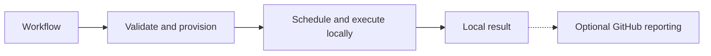

# wsr — workflow sandboxed runner

WSR is a pre-alpha project for running and debugging CI locally, independently of GitHub
scheduling or service availability when required inputs are cached. The WebAssembly Component Model is central to the
planned deny-by-default security model; existing tools use a separately isolated system backend.



## Current status

The checked-out implementation is a Rust workspace and CLI scaffold. Typed argument parsing,
help/version, shared types, and CLI contract tests exist. `wsr inspect <file>` now reports a
[small static GHA source subset](docs/cli/README.md#static-workflow-inspection) without executing it.
The other ten operational paths remain placeholders. Workflow execution, permission enforcement,
hook installation and Component providers are not implemented.

Substantial unpublished prototype code is preserved in a local July 29 stash. It includes
inspection/planning, source snapshots, a development command backend, and GitHub adapter work.
That prototype is not in this checkout or a supported release. Its tests have not been run as
part of the current audit or documentation reconciliation.

## Accepted product direction — planned

- Run and debug a documented subset of GitHub Actions workflows locally first.
- Reuse verified cached actions and tools, acquiring approved missing inputs on demand.
- Execute cached jobs again; prior successful results are not a substitute for execution.
- Add GitHub reporting, hosted reuse and attestations through optional integrations.
- Compile provider input into a provider-neutral workflow model with source traceability.
- Use signed Component Model provider plugins and explicit capability-based component execution.
- Run ordinary commands through an isolated Linux system backend; reject execution when required
  restrictions cannot be enforced.
- Support Linux jobs from macOS and Linux development machines first. Native macOS and Windows
  jobs come later; CPU architecture support remains open.
- Assume workloads may be malicious. Workflow requests do not authorize their own permissions.
- Offer explicitly owner-authorized broad runner access as an exception to the default policy.
  Wildcard scope and syntax remain open; broader permissions do not establish full compatibility.

Use Bun for compatible GHA JavaScript actions inside the isolated system backend; the provider
adapter and provider-neutral core remain. See the [GHA design](docs/provider/gha/README.md).

Runner provisioning, scheduling/dispatch, enforcement, observability and evidence have separate
[owning guides](docs/README.md). Normal YAML edits and downloads are progress; blocked requirements
produce diagnostics. Global job concurrency defaults to no count cap, with policy/resource checks.

These are design decisions, not available features. Concrete runtime versions, system backends,
outer isolation, grant syntax, and the first tested compatibility subset remain unresolved.

## Development

There is no supported workflow-execution quick start yet. To inspect the scaffold's CLI:

```sh
cargo run -p wsr -- --help
cargo xtask check
cargo xtask test
cargo xtask ci
```

The workspace uses the [rust-template tooling snapshot](docs/development/template-migration.md), with sixteen
product crates and private `tools/xtask` automation. Product crates declare Rust 1.85 as their minimum
version and the development toolchain tracks stable. Future runtime/toolchain choices remain open. No installer or schema
URL is advertised as a working onboarding path.

Unit tests and Cargo integration tests drive implementation through TDD. The
[testing guide](tests/README.md) explains how the manual-only example workflows become
shared GHA-to-IR and execution test inputs as those capabilities are implemented.

## Documentation

| Document | Responsibility |
| --- | --- |
| [Project context](docs/context/README.md) | Reading order, authority and task-specific guides for contributors and agents |
| [Decisions](docs/context/decisions.md) | Authoritative accepted decisions, proposals, and open questions |
| [Architecture](docs/context/architecture.md) | Current scaffold and target component boundaries |
| [Roadmap](docs/context/roadmap.md) | Delivery order and completion gates, without release-date promises |
| [Implementation status](docs/context/status.md) | Evidence-based implementation accounting |
| [Security model](docs/security/README.md) | Planned security contract and its limits |
| [Documentation index](docs/README.md) | Subsystem guides and documentation maintenance rules |
| [Template migration](docs/development/template-migration.md) | Tooling provenance, local commands, and update/recovery rules |
| [Crate inventory](crates/README.md) | Existing workspace contents, not a required future layout |

The [organization repository](https://github.com/ectorial/.github) owns the profile and governance.
It summarizes this repository's direction rather than defining a separate technical roadmap.

See [CONTRIBUTING.md](CONTRIBUTING.md), [SECURITY.md](SECURITY.md), and the
[Code of Conduct](CODE_OF_CONDUCT.md). Licensed under [MIT](LICENSE).
