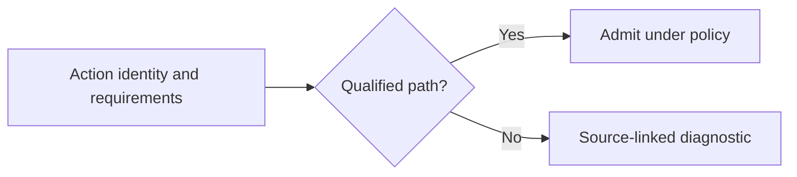

# GHA compatibility contract

**Accepted direction; all product behavior below is unimplemented.** Selecting Bun is a design
choice, not evidence that arbitrary Node-targeted actions work. The supported subset grows only with
named fixtures and recorded results. Runtime versions and action revisions must be identified in evidence.

## Planned categories

| Source construct | Intended handling | Gap before support |
| --- | --- | --- |
| Workflow jobs, dependencies, conditions, matrices | Provider lowering and core evaluation/scheduling | Canonical semantics, diagnostics, and fixtures |
| `run:` steps | Approved shell/tool in isolated system backend | Defaults, working directory, environment, exit and cancellation behavior |
| JavaScript `uses:` actions | Bun within isolated system execution | Declared runtime requirement, entrypoints, dependencies, APIs, and lifecycle qualification |
| Composite actions | Lower nested steps while retaining source and action scope | Inputs/outputs, conditions, nesting, and cleanup semantics |
| Container actions and service containers | Explicit container requirements | Backend selection and MVP scope remain open; Bun does not supply container semantics |
| Local and remote action references | Resolve identity and metadata without executing action code | Pinning, integrity, path safety, acquisition policy, and provenance |
| Reusable workflows | Provider lowering with explicit invocation boundaries | Inputs, secrets, permissions, outputs, and recursion rules |
| Component artifacts | Preferred when semantics and host interfaces are compatible | GHA mapping/discovery and component execution contract remain open |

## Bun qualification

Preserve the source `runs.using` declaration as a compatibility requirement and record Bun as the
actual runtime. Never relabel an untested substitution as native Node execution. Evaluate module
loading, filesystem/path behavior, process/environment APIs, subprocesses and signals, networking/TLS,
native dependencies, toolkit commands, and pre/main/post entrypoints against the declared source
semantics. A passing hello-world action does not qualify all actions or all Node API families.

Bun's [Node.js compatibility reference](https://bun.sh/docs/runtime/nodejs-compat) describes runtime
coverage and exceptions; it is not WSR certification. Version selection, distribution/integrity checks,
offline provisioning, and the initial tested API subset are open. Running an action under Bun and
bundling it into an executable require separate evidence; bundling is not selected for the MVP.

## Classification and diagnostics

Use the existing categories: native, faithfully emulated, fallback-required, unsupported, or unknown.
Define their precise per-feature criteria before exposing a stable result schema. Reports must name
the action identity, source location, requested semantics, selected runtime/backend and version,
relevant capabilities, and the reason for any limitation. Unknown or unsupported behavior blocks the
affected plan unless an explicit, qualified alternative is selected before side effects.

Broader grants cannot fix missing APIs or semantics. No silent Node fallback, QuickJS layer, or
JavaScript-to-Wasm conversion is approved by this design. Failure under Bun does not trigger replay.

## Upstream references

Use GitHub's [action metadata reference](https://docs.github.com/en/actions/reference/workflows-and-actions/metadata-syntax)
and [JavaScript action guide](https://docs.github.com/en/actions/tutorials/create-actions/create-a-javascript-action)
when defining fixtures. Record the source assumptions with fixtures and recheck changing runtime
requirements. These references describe upstream behavior, not implemented WSR support.
