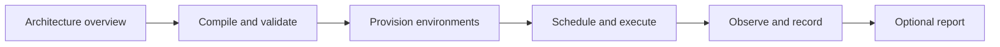

# WSR design documentation

The checkout is a CLI/types scaffold. The following documents specify planned behavior, open
contracts and verification requirements. Start with the architecture, then follow one subsystem.

## Ownership map

| Guide | Owns |
| --- | --- |
| [Decisions](../PLAN.md) | Accepted direction and open decisions |
| [Architecture](../ARCHITECTURE.md) | Whole-system responsibilities and handoffs |
| [Providers](provider/README.md) | Syntax/semantic lowering and provider plugin boundary |
| [GHA provider](../crates/wsr-gha/README.md) | GHA action/state/compatibility contracts |
| [Planning and validation](planning/README.md) | Structural validation, binding and admission phases |
| [Runner provisioning](provisioning/README.md) | Profiles, tools, dependency closure and environment readiness |
| [Content cache](cache/README.md) | Verified immutable reuse, acquisition, deletion and retention |
| [Trusted policy](policy/README.md) | Requests, grants and admission authority |
| [Engine](engine/README.md) | Scheduler, dispatcher, supervisor and job lifecycle |
| [Execution backends](sandbox/README.md) | Platform and enforced isolation mechanisms |
| [Observability](observability/README.md) | Scoped logs/metrics, device pressure and contention |
| [Evidence](evidence/README.md) | Results, artifact identity and optional attestations |
| [Integrations](sync/README.md) | Optional publication/hosted reuse and external dependencies |
| [Configuration](config/README.md) | Repo/global settings, pins and metadata proposals |
| [Security model](SECURITY-MODEL.md) | Threat model, invariants and residual risks |
| [CLI](cli/README.md) | Actual scaffold behavior and open interface |
| [Roadmap](../ROADMAP.md) | Delivery gates |
| [Checklist](../CHECKLIST.md) | Implemented behavior with evidence |
| [Testing plan](TESTING-PLAN.md) | Development and compatibility test strategy |
| [Coverage index](TEST-COVERAGE.md) | Observed evidence and pending tests |
| [Testing WSR](../tests/README.md) | Exact current commands and fixture conventions |
| [Template migration](TEMPLATE-MIGRATION.md) | Tooling provenance and recovery rules |
| [Crates](../crates/README.md) | Source inventory, maintenance dispositions and publication constraints |

## Historical records and paused work

These records remain at their existing paths to preserve links and evidence. They are not active
specifications or permission to execute historical next-action commands.

| Record | Status and authority |
| --- | --- |
| [CLI skeleton plan](cli/SKELETON-PLAN.md) | Completed implementation record; the [CLI guide](cli/README.md) owns current behavior. |
| [Design refactor record](implementation/design-docs-refactor.md) | Historical audit and completed documentation separation; current contracts live in the ownership map above. |
| [Java worker](implementation/java-e2e.md) | Paused worker contract; explicit resumption is required before implementation. |
| [Java progress](implementation/java-progress.md) | Dated preparation evidence; its current checkpoint supersedes historical next actions. Machine-local artifacts are not clean-clone inputs. |

## Walkthroughs and proposals

[Java](dx/java.md), [Python](dx/python.md) and [Node](dx/node.md) show simulated target experiences.
Their adjacent YAML files remain reference inputs outside .github/workflows. Their A/B choices
require decisions before implementation. Shared contracts above override illustrative logs/paths.

Maintain one owner for each contract. PLAN records authority and status; detailed guides own the
explanation. Preserve historical test/prototype evidence instead of relabelling it as implementation.
When a decision changes, reconcile overview, subsystem, security, tests and affected walkthroughs.
Organization summaries should link to this design without introducing separate runtime commitments.

For cleanup, classify content as active, planned, historical, superseded or an archive candidate.
Age or lack of implementation alone does not invalidate an accepted design. Preserve decisions,
licenses, release history, native-reference evidence, migration backups and the prototype stash.
Label historical records and remove them from active guidance before considering relocation;
any later move must repair incoming links and preserve provenance. Do not duplicate subsystem
contracts in a new cleanup roadmap. Package dispositions live in the crate inventory.
