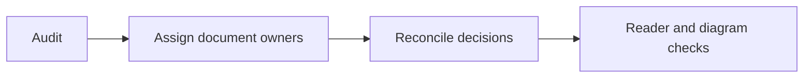

# Design documentation separation audit and refactor plan

> Status: **historical audit and completed documentation-refactor record**. The current disposition
> and validation record below preserve the outcome. Earlier findings and proposed sequences are
> not a new work queue or authority over [PLAN.md](../context/decisions.md) and the subsystem guides.

Reviewed November 5, 2026. The owner subsequently authorized the documentation refactor. The existing dirty documentation and
prototype stash are preserved. This plan proposes document ownership and sequencing, not
production interfaces, new crates, a selected backend or implemented capabilities.

## Historical assessment before the refactor

At the pre-refactor audit, the documentation was partially aligned. ARCHITECTURE.md already separates provider compilation,
planning/policy, provisioning, supervision, backends and results. D-012 ends provider callbacks at
compilation; D-016 owns state/lifecycle; D-025 requires tool preflight; D-026 separates repository
observability from shared resource measurements. These boundaries should be retained.

The latest owner direction is independent local execution with an offline-capable core,
on-demand verified tools, shared immutable caches and deny-by-default enforcement. Optional
GitHub communication and attestations follow execution. These refinements require formal decision
updates before describing them as settled interfaces or security guarantees.

## Historical findings and planned disposition

| Finding | Evidence | Refactor action |
| --- | --- | --- |
| Provisioning lacks a subsystem owner | D-025 and docs/engine/README.md contain the contract; no runners/provisioning guide exists | Extract provisioning ownership and link engine responsibilities to it |
| Validation has several meanings | Provider diagnostics, planner admission, artifact verification and TESTING-PLAN coexist | Name each validation stage and its authority; keep development tests separate |
| Scheduler/dispatcher contract is open | PLAN decision queue item 16; engine guide combines broad responsibilities | Document ready/blocked jobs, device admission, dispatch and supervisor ownership separately |
| New concurrency proposal is absent | No saved max-jobs configuration contract | Formalize owner preference max-jobs=0, admission checks, queue reasons; leave exact schema and fairness open |
| Independent execution is underspecified | D-017 and docs/sync prioritize running inside GHA, then independent CI | Distinguish independent local engine from remote CI hosting; revise delivery language around offline-first core |
| Bootstrap/acquisition policy needs reconciliation | D-010 allows provider download during repository commands; D-025 requires missing tool acquisition | Define preparation versus offline execution, missing-object diagnostics and explicitly enabled acquisition |
| Evidence/signing lacks an owner | Architecture has results/evidence, but no attestation contract | Add evidence boundary; keep signing trust and optional publication separate |
| Cross-repository telemetry is documented, coordination is not | D-026 and observability diagrams anticipate a coordinator | Specify emitted lifecycle/resource events without assuming daemon implementation |
| Profiles and repository metadata remain conversational proposals | Configuration schema remains open in D-023 | Track runner/tool catalogs, custom profiles, lockfile and .wsr layout as proposals |
| DX guides and worker contract can drift | Simulated Java/Python/Node guides; Java worker still prioritizes Docker native reference | Reconcile scenarios and future worker instructions after the architectural decisions are recorded |

## Ownership proposed during the audit

Paths marked new are planned destinations, not existing specifications.

| Document | Owns | Boundary |
| --- | --- | --- |
| PLAN.md | Decisions, unresolved questions, dependency order | Links to detailed subsystem contracts |
| ARCHITECTURE.md | Whole-system map, authority boundaries, lifecycle | Overview rather than duplicated schemas |
| docs/provider/README.md and crate GHA docs | Source syntax, expression lowering, provenance and compatibility | No workload execution or global scheduling |
| docs/planning/README.md (new) | Canonical validation, input binding, graph/matrix evaluation and requirements | Dynamic expressions evaluated at the appropriate lifecycle phase |
| docs/provisioning/README.md (new) | Runner profiles, package resolution, dependency closure, acquisition and environment assembly | Consumes authorized acquisition policy; no repository fairness decisions |
| docs/cache/README.md (new) | Immutable content identities, trust states, atomic publication, leases and retention | Separate secrets and mutable run state |
| docs/policy/README.md (new) | Trusted grants and admission rules | Repositories request authority; backends enforce granted access |
| docs/engine/README.md | Scheduling, device admission, dispatch, supervisor state and job outcomes | Separate scheduler/dispatcher sections before considering more files |
| docs/sandbox/README.md | Backend capabilities, platform matching, isolation and lifecycle enforcement | Docker/VM/Wasm selection remains a separate decision |
| docs/evidence/README.md (new) | Result identity, artifact digests, provenance and proposed attestations | Signing claims requires explicit trust/verification policy |
| docs/observability/README.md | Event correlation, logs, attributed resources, visibility and retention | Metrics are observations, not automatically evidence of truthful workload results |
| docs/sync/README.md | Optional GitHub/other connectors, publication queue and retries | Core execution cannot depend on external reporting availability |
| docs/config/README.md | Repo config, trusted global config, pinning and metadata ownership | Define precedence and separate requests from grants |
| docs/TESTING-PLAN.md and TEST-COVERAGE.md | Test strategy and observed evidence respectively | Planned tests remain distinct from passing coverage |

## Validation stages to document

1. Source validation checks syntax and supported provider semantics.
2. Canonical validation checks model integrity, references and dependency constraints.
3. Admission checks platform/backend support, authorized capabilities and tool support.
4. Acquisition verification checks sources, package identities, integrity and dependency closure.
5. Dispatch admission rechecks current capacity, policy applicability and environment readiness.
6. Runtime enforcement applies grants and handles dynamic state at step boundaries.
7. Result verification checks output/artifact identities; attestation verification checks signer
   trust and claim policy. A signed success claim alone does not prove correct execution.

These are conceptual responsibilities. Their exact APIs and persisted schemas require later design.
Static parsing cannot enumerate arbitrary dynamic commands; D-025 discovery limits must survive
refactoring. Existing setup actions must retain their timing, requested versions and effects.

## Lifecycle and interface questions

The architecture overview should show source/input compilation, planning/admission, provisioned
requirements, ready-job scheduling, dispatch, supervised execution, result collection and optional
publication. Policy and observability cross these stages. Cached offline inputs must suffice for
execution; external-service calls explicitly requested by a workload remain external dependencies.

Define conceptual handoffs before coding: compiled model plus diagnostics; requirements and pins;
prepared environment identity and capabilities; eligible job and resource budget; supervisor
state/events; immutable result/evidence bundle. Do not freeze these as Rust structs in this refactor.

For provisioning versus scheduling, choose whether downloads occur before resource reservation
or use separate bounded preparation capacity. Avoid reserving scarce execution resources during
long downloads without an explicit rule. Dispatch must handle preparation failure and cancellation.

For background operation, decide foreground ownership versus optional shared coordinator, local
client authentication, persistence/reconnect, fairness and crash reconciliation. The owner's global
job-count preference is 0 for no count cap; hardware capacity and policy admission remain effective.

## Historical refactor sequence

1. Update authoritative decisions for offline-first execution and optional reporting. Reconcile
   D-010, D-017, D-023, D-025 and D-026; record unresolved schemas and trust choices explicitly.
   Verify each new claim traces to owner direction or remains labelled a proposal.
2. Rewrite the architecture overview around the responsibility map and validation stages. Add
   one lifecycle diagram with independent acquisition and optional reporting boundaries.
   Verify there is no required GitHub control-plane call in the core path.
3. Extract provisioning/cache/policy guides from existing decisions, preserving source links.
   Specify catalog/profile/package distinctions and dynamic-tool limits. Keep backends undecided.
4. Refine engine scheduling/dispatch/supervision and its conceptual handoffs. Add a two-repository
   sequence with ready/blocked states, count/resource admission, cancellation and queue telemetry.
5. Define evidence and optional connector boundaries, then align config and observability links.
   Document secret handling, replay/idempotency and publication outages without selecting a service.
6. Reconcile README, ROADMAP, CHECKLIST, provider/backend docs, DX examples, tests guide and Java
   worker contract. Identify any automation-prompt change as a separate explicit operation.
   Check organization summaries for material product-story changes, preserving unrelated edits.
7. Check internal links/anchors, Mermaid syntax/rendering and terminology. Run git diff --check.
   A documentation move must preserve decisions, open questions and implementation status.

## Refactor completion criteria

Each responsibility has one owning specification; overview/index docs link to it. Every handoff
has inputs, outputs, failure/cancellation behavior and an authority boundary. Known contradictions
are resolved or explicitly recorded. Offline acquisition rules, cache isolation, runner identity,
GHA setup semantics and dynamic state are consistently described. Scheduling and provisioning
can be designed independently against the agreed handoff. Existing source remains scaffold until
behavioral implementation/tests justify a status change.

## Refactor execution record — November 5, 2026

Implemented the documentation ownership map with planning, provisioning, cache, policy and evidence
guides. Rewrote engine/config/integrations and the architecture/index. Refined D-017 and added
D-027–D-030 to distinguish cached local execution, scheduling count policy, metadata proposals and
optional attestations. D-025/D-026 and prior security/provider decisions remain traceable.

Reconciled roadmap/checklist, CLI, security, provider/backend guides, GHA contracts and walkthrough
scope. Added small Mermaid diagrams across the active design guides. Historical reference results
remain historical. No product runtime, scheduler, catalog schema, attestation format, or new CLI
command was implemented. The daemon, fairness, state persistence and provisioning APIs remain open.

The saved automation prompt is outside this documentation refactor. Review it separately before
resuming implementation because it retains earlier native-reference priorities. Organization
summaries are synchronized only for product-direction wording, with profile/template agreement.

Validation results are recorded in the final handoff. Runtime behavioral claims require their own
TDD evidence. This record is completion of document separation, not completion of open designs.

### Current disposition — November 5, 2026

| Original finding | Disposition after PR #17 |
| --- | --- |
| Provisioning ownership | Resolved by the provisioning guide |
| Validation meanings | Separated by the planning guide |
| Scheduler/dispatcher | Responsibilities separated; mechanisms remain open |
| Concurrency preference | Recorded in D-028; schema/fairness remain open |
| Independent execution | Refined in D-017/D-027 and integration guide |
| Acquisition rules | Recorded in D-027 and cache/provisioning guides |
| Evidence ownership | Added evidence guide and D-030; formats/trust remain open |
| Telemetry coordination | Cross-subsystem ownership documented; daemon remains open |
| Profiles and metadata | D-029/configuration preserve schema proposals explicitly |
| DX/worker drift | Follow-up audit corrects platform/preflight examples and current handoff |

The follow-up cleanup is a documentation correction. It supplies no runtime implementation.
Companion organization-summary publication has a separate repository/PR lifecycle; local
synchronization alone does not establish that GitHub's organization profile was updated.

### Validation record

Offline cargo xtask ci passed after the documentation refactor. All 38 Mermaid diagrams parsed
and rendered with Mermaid in headless Chrome; representative overview, provisioning, engine and
evidence diagrams were visually inspected. Local relative links/anchors passed across 37 Markdown
files. git diff --check passed in WSR and the companion organization-summary checkout. A fresh
reader review resolved preflight/output-dependent requirements and optional unsigned publication.
Ignored validation artifacts are under target/wsr-tests/design-refactor-20261105.
