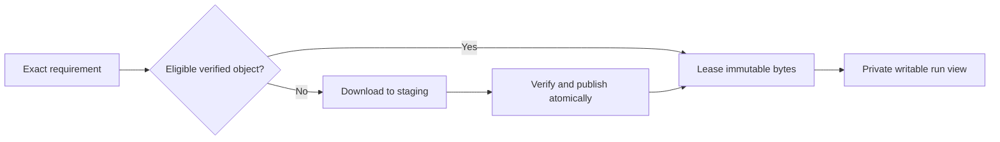

# Shared immutable content cache

## Contract and status

D-013, D-014 and D-027 define a per-user local content store shared across repositories. It is
unimplemented. Storage format, locks, leases, signature policy and maintenance commands are open.

Providers, actions, toolchains and safely reusable derived artifacts have distinct identities.
Derived keys include inputs, compiler/provider/runtime, target, configuration and relevant policy.
Never select content by filename alone. Secrets, credentials, mutable workspace state and unredacted
logs remain outside this store. Cached packages do not grant execution authority.

## Hits, misses and upstream deletion

Use verified exact pinned objects without routine upstream checks. A cached action remains usable
after upstream deletion. On a miss, fetch the exact revision when acquisition is allowed. Distinguish
confirmed unavailability from network, rate-limit and authentication errors. Never substitute a
different version. Offline misses provide preparation guidance. YAML changes alone are routine
resolution events and produce no warning.

Verify eligibility/integrity on use under the eventual verification policy. Quarantine corrupt
objects and reacquire when authorized. Rechecking every byte versus verified metadata/revalidation
strategy is open. Locally known revocations block use. Required remote revocation freshness is
explicit policy and can restrict offline operation.

## Publication and collection

Concurrent downloads for one identity need coordinated staging and atomic publication. One run's
cancellation must not remove bytes or transfers leased by another run. Expose acquisition/wait
events without leaking repository details. Archive extraction must reject traversal and unsafe links.

Retained repository pins are normal collection roots. Running uses require leases. Explain retention
and disk pressure. Explicit forced purge may remove a pinned object only with clear consequences
for future availability. Discovering repository roots, stale pins and lease recovery are open
mechanisms. Never silently alter a repository pin to recover from eviction.

## Verification

Cover concurrent publication, integrity failure, deletion upstream after a cache hit, offline misses,
revocation, active-use retention, forced removal, trust separation and pin-preserving repair.
A reusable input is different from reusing a previous successful test result. Jobs execute again.
