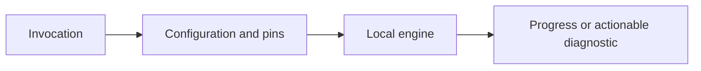

# CLI



## Current scaffold

[Typed argument definitions](../../crates/wsr-cli/src/lib.rs) use clap;
[dispatch](../../crates/wsr/src/commands/mod.rs) selects eight handlers: `init`, `run`, `daemon`,
`list`, `inspect`, `cache`, `hook`, and `status`. These cover eleven operational leaf paths,
including `cache list/verify/purge` and `hook install/remove`.

The ten remaining placeholder leaves write `error: wsr <command>: not implemented yet` followed by a newline
to stderr, leaves stdout empty, and exits with code 1. The command name includes the nested
leaf, such as `wsr cache verify`. Those placeholders open no workflow file and initialize no configuration, hook, cache,
service, provider, or execution backend. Supplied nonexistent paths reach the same placeholder.
`inspect` instead implements the bounded source-inspection contract below.

Help and root version reporting exit with code 0 and write to stdout. Invalid syntax, omitted
required arguments, and bare `wsr`, `wsr cache`, or `wsr hook` exit with code 2 and write Clap
diagnostics or usage/help to stderr.

`run` defines an optional file and `--event`, `--dry-run`, `--verbose`, `--yes`, and `--format`.
Workflow paths are `PathBuf` values, and `--format` accepts only `human` (default) or `gha`.
These are parsed arguments, not implemented execution/planning/reporting behavior. `--yes` does
not grant access. Help text can be inspected with `cargo run -p wsr -- --help`.

## Static workflow inspection

`cargo run -p wsr -- inspect path/to/workflow.yml` reads only the explicit local UTF-8 YAML
source. The temporary built-in GHA compiler is authorized by D-031. It returns a temporary GHA-derived
source summary (D-033), not executable IR or a signed Component compilation result.

Current supported subset:

- Optional literal workflow `name` and optional scalar/mapping manual trigger; the trigger is
  reported, never evaluated. Absence of `on` is accepted for inspection fragments.
- Optional workflow `run-name` source text, reported but never evaluated; see [run names](#unevaluated-run-names).
- A nonempty `jobs` mapping with unique string identifiers, ordered lexicographically in output.
- Job `name`, a nonempty literal string or string-list `runs-on` requirement, optional static `needs`, and a nonempty ordered `steps` sequence.
- Step `name`, optional explicit `id`, and exactly one nonempty string `run` or `uses`. Scripts are not printed or retained
  in the summary; action references are reported verbatim, never resolved, fetched or opened.

Names are optional strings (null is treated as absent). Required strings retain their YAML type;
numbers and booleans are rejected. Display values escape control characters. Each successful report
states that execution compatibility is not assessed; runner names do not establish environment support.

Success exits 0 and writes a deterministic human-readable summary to stdout, with empty stderr.
Unreadable/malformed source, invalid supported shapes, unknown fields and expressions in inspected
strings exit 1, leave stdout empty and write a diagnostic to stderr. Diagnostics identify the file;
YAML decoding errors include available line/column information and structural context. Semantic
checks identify a field path (step indices are one-based). Dynamic values are explicitly unevaluated.
Clap invocation errors retain exit code 2. The output is pre-alpha, not a frozen machine protocol.

The source must be a regular file (symlinks are followed); directories, FIFOs and devices such as
`/dev/zero` exit 1 with a `not a regular file` diagnostic and are never read. WSR imposes no size
limit (D-032). When a successfully inspected file exceeds GitHub's documented 500 KB limit, read by WSR
as 512,000 bytes (GitHub does not define the unit), one line is written to stderr before the unchanged report, and the exit code stays 0:
`warning: wsr inspect: ci.yml: 512001 bytes exceeds GitHub's documented 500 KB (512000-byte) workflow
file limit; GitHub would not run this workflow`. A closed stderr does not stop the report. Because workflow content is untrusted, diagnostics are written with control characters
and other unprintable characters escaped (`\n`, `\t` or `\u{…}`), so no raw terminal escape sequence, bidi override or
isolate, or zero-width character reaches stderr (`jobs.b\u{202e}: invalid job identifier 'b\u{202e}'`).
Every character `char::escape_debug` escapes is escaped, including combining marks; quotes and
backslashes stay as written. If stdout is closed early (for example
`wsr inspect big.yml | head -1`), the command stops writing and exits 0 quietly, without a panic.

Other trigger forms, runner-group objects, matrices, conditions, environment,
services and other GHA constructs are rejected explicitly in this first slice.
The rejection is a limit of current inspection support, not a claim that the workflow is invalid GHA.
Broader inspection remains pending.

### Manual-trigger input declarations

`on: workflow_dispatch`, `on: {workflow_dispatch: null}`, an empty dispatch mapping,
and a dispatch mapping with `inputs` are supported. Other events and event sequences remain
explicitly unsupported. Missing `on`, null dispatch bodies, absent inputs and empty input mappings
remain distinct in the source summary, though the trigger-only CLI line is the same.

Inputs display in identifier order, with only explicitly declared description/type/required/default/
options metadata. Types are string, boolean, number, choice and environment; omission is preserved.
Defaults retain string/boolean/number kind and render as `Default: "pass" (not applied)`.
Numbers are rendered from the YAML number value; original numeric lexemes are not retained.
Choices render quoted options in declared order, including repetitions. Text is escaped.
Inspection neither supplies values nor prompts for required inputs, selects environments, applies
defaults or evaluates expressions.

Declarations require unique string identifiers beginning with an ASCII letter/underscore, followed
by letters/digits/underscores/hyphens. Metadata types are strict: no scalar coercion. Null metadata,
unknown fields, duplicate keys and expressions fail before stdout. Choice declarations require
nonempty options; options on other types (including omitted type) fail. Boolean defaults must be
booleans; string/choice/environment defaults must be strings. Omitted type uses the string rule
for validation but is not inserted into the summary. Numeric-type defaults retain any supported
scalar, matching the pinned schema/converter's validation boundary; this does not certify numeric
input compatibility. Choice defaults are not checked for membership in options by this subset.

Diagnostics identify the file and structural route, such as
`on.workflow_dispatch.inputs.mode.options[2]` or `on.workflow_dispatch.inputs.bad id: invalid
input identifier 'bad id'`. YAML duplicate-key/parse errors retain available source context;
semantic checks do not introduce exact source spans. The pinned official schema
and converter references and intentional source-preservation differences are recorded in the
[iteration record](../implementation/inspection-dispatch-inputs.md).

The canonical example workflows still contain unsupported fields outside these declarations.
Their manual reference runs are not evidence of WSR execution support.

### Unevaluated run names

An optional workflow `run-name` must be a nonempty string; null, booleans, numbers, lists,
mappings and blank text fail before stdout with a `run-name` diagnostic. Its decoded text is
reported on the line after the workflow name, with control characters escaped:

```text
Run name: Local reference (literal)
Run name: Shell reference — ${{ inputs.mode }} (unevaluated; expression syntax not validated)
```

Text containing a `${{` opening fence is classified as unevaluated and retained whole, including
multiple, multiline or unterminated fences. This is not an expression parser: no syntax is validated,
no context or input is looked up and no default replaces `inputs.mode`. Omission adds no line.
The [pinned workflow schema](https://github.com/actions/languageservices/blob/4043eda158e16579cc5fb1b0b07a4bce2a76f0b5/workflow-parser/src/workflow-v1.0.json)
defines `run-name` as a string with `github`, `inputs` and `vars` contexts; WSR does not bind them.
Other fields keep their literal-only expression rejection.

### Requested permissions

Workflow-level and job-level `permissions` accept the `read-all`/`write-all` shorthands or a
mapping (possibly empty) from a scope in the
[pinned workflow schema](https://github.com/actions/languageservices/blob/4043eda158e16579cc5fb1b0b07a4bce2a76f0b5/workflow-parser/src/workflow-v1.0.json)
to `read`, `write` or `none`; `id-token` and `copilot-requests` take only `write`/`none`,
`models` and `vulnerability-alerts` only `read`/`none`. The workflow request follows the trigger
lines, and a job's request follows its runner and needs lines, with scopes sorted by name:

```text
Permissions: read-all (requested; not granted)
Permissions (requested; not granted):
  contents: read
Permissions: {} (requested; not granted)
```

These are source requests only. Inspection grants no token, does not combine a job's request with
the workflow's or with repository defaults, and does not enforce any permission. Null and other
scalars, sequences, unknown or non-string scopes, levels outside a scope's set and duplicate scopes
fail before stdout (`permissions.secrets: unknown permission scope 'secrets'`,
`jobs.b.permissions.models: expected read or none`). The pinned schema gives `permissions` no
expression context, so `${{` text fails as an unevaluated expression the field does not allow.

### Job timeouts and step shells

A job's `timeout-minutes` and a run step's `shell` are reported as source data on lines after the
job's runner, needs and permissions lines and after the step line:

```text
  Timeout minutes: 5 (not applied)
  Timeout minutes: ${{ inputs.minutes }} (unevaluated; expression syntax not validated; not applied)
  Step 1: run
    Shell: bash (not selected)
```

A timeout must be a finite positive YAML number (a WSR subset rule; the schema sets no minimum), rendered from the number value, or text with a
`${{` fence, which stays unevaluated as for `run-name`. A shell must be a nonempty string on a
`run` step; the [pinned workflow schema](https://github.com/actions/languageservices/blob/4043eda158e16579cc5fb1b0b07a4bce2a76f0b5/workflow-parser/src/workflow-v1.0.json)
gives `shell` no expression context, so `${{` text fails, as does `shell` on a `uses` step.
No timeout is applied and no shell is selected, located or invoked. Step `timeout-minutes` and
`cancel-timeout-minutes` remain unsupported.

### Step environment, action inputs and working directories

Step `env` (any step), `with` (`uses` steps only) and `working-directory` (`run` steps only)
are reported after the step line, with keys sorted and values shown with their YAML type:

```text
  Step 1: uses actions/checkout@…
    With (not passed to any action):
      persist-credentials: false
      python-version: "3.13"
  Step 3: run (…)
    Working directory: examples/python-basic (not resolved)
    Env (not bound):
      WSR_EXAMPLE_MODE: "${{ inputs.mode }}" (unevaluated)
```

Following the [pinned workflow schema](https://github.com/actions/languageservices/blob/4043eda158e16579cc5fb1b0b07a4bce2a76f0b5/workflow-parser/src/workflow-v1.0.json),
values may be strings, numbers or booleans; strings are quoted and escaped, and text with a `${{`
fence is marked unevaluated. An empty mapping renders as `{}`. No variable is bound, no input is
passed to an action, no directory is resolved and no expression is evaluated.

Non-mapping values, empty keys, null or nested values, keys duplicated ignoring case (as the pinned
parser rejects), `with` on a `run` step, `working-directory` on a `uses` step and blank or
non-string directories fail before stdout (`jobs.b.steps[1].env.A: expected a string, number or
boolean`). A whole-mapping expression, an expression in a key or a number/boolean key is valid GHA
that is reported as unsupported. Placement is checked before contents.

### Workflow and job environment and run defaults

Workflow-level and job-level `env` follow the step `env` rules above and render, unindented or
under the job, as `Env (not bound):`. `defaults.run` at either level accepts only `shell` and
`working-directory` strings and renders as source data; a job's values are never merged with the
workflow's and nothing is applied to any step:

```text
Env (not bound):
  MODE: "${{ inputs.mode }}" (unevaluated)
Run defaults (not applied):
  Shell: bash
  Working directory: src
Job: b
  Runner: linux
  Run defaults (not applied):
    Shell: ${{ matrix.shell }} (unevaluated; expression syntax not validated)
```

`defaults: {}` and `defaults: {run: {}}` both render `Run defaults (not applied): {}`. Following the
pinned schema, workflow and job `env` and job `defaults.run` have expression contexts: an expression
replacing the whole mapping is unsupported, and job `shell`/`working-directory` text with a `${{`
fence (or an expression key) is reported as unevaluated or unsupported. Workflow `defaults.run` and
`defaults` itself have none, so an expression there is invalid (`defaults.run.shell: expression is unevaluated and not allowed in
workflow defaults`). Unknown keys (``defaults.run: unknown field `bogus`, expected `shell` or
`working-directory` ``, routed to the key), non-mappings, null or nested values and empty strings
are invalid. Number and boolean values, which the pinned reader converts to strings, are unsupported.
A blank shell is invalid and a blank directory unsupported, as for steps.

### Literal runner labels

`runs-on` accepts a nonempty scalar string or nonempty list of nonempty strings.
Scalars retain `Runner: ubuntu-latest`; lists render as
`Runner labels: ["self-hosted", "linux", "x64"]`, including quoted/escaped labels.
Source form, order, exact spelling and repetitions are preserved; a one-element list stays a list.
No runner is discovered, selected or provisioned, and labels do not establish platform support.

Null/non-string values, nested lists, empty lists and blank members fail before stdout.
Runner-selector mappings are explicitly unsupported. Expressions are unevaluated and rejected,
including inside lists. Semantic diagnostics identify `jobs.build.runs-on[2]` for a second label;
decoding errors retain available source context. No normalization or label resolution occurs.

### Explicit step identities

An explicit `steps[].id` is retained in the source summary and displayed as
`Step 1 [compile]: run (Compile sources)` or `Step 2 [upload]: uses owner/action@v1`.
Steps without IDs retain their previous output; inspection never generates an ID or changes step
order. IDs do not resolve outputs or expressions, select steps, or establish runtime identities.

An ID must be a nonempty string of fewer than 100 ASCII identifier characters: a letter or
underscore first, then letters, digits, underscores or hyphens. The `__` prefix is reserved.
Explicit null/non-string values and expressions fail. Duplicate IDs within one job fail with
both the first and repeated structural step locations; exact spelling is used for comparison.
Case variants and reuse across different jobs are accepted. Semantic diagnostic indices are
one-based. Validation completes before stdout is rendered; existing graph checks remain in force.

### Static dependency inspection

`needs` accepts one literal job identifier or a list of identifiers. Omission and `[]` mean no
edges. A nonempty dependency list renders after the job's runner line as `Needs: build, test`.
Declared dependency order and repetitions are preserved. Job display order remains lexicographic,
not an execution schedule. See the [shared fixture](../../tests/fixtures/inspection/static-needs.yml).

All targets must name jobs in this workflow, using exact identifiers. Forward references, valid
diamonds, repeated edges and disconnected jobs are supported. Unknown targets are checked before
cycle detection. Self-dependencies and longer cycles fail with explicit diagnostics; a downstream
job blocked by a cycle is not reported as a cycle member. Validation uses an explicit traversal
stack rather than recursive calls, including a tested 4,096-job chain.

Malformed types, null, empty identifiers and expressions in `needs` fail before any stdout summary.
Job identifiers are validated before `needs` is resolved, so an invalid identifier is reported
ahead of an unknown dependency.
A job identifier is also validated before its body is decoded, so a hostile identifier cannot forge
the route of a body diagnostic; when both are wrong, the identifier is the one reported. An expression in a field the pinned schema gives no expression
context (workflow `name`, `on`, job and step identifiers, `needs`, `uses`, manual-input
declarations) is invalid; where the schema allows expressions (job and step `name`, `run`,
`runs-on`) it is valid GHA that inspection does not evaluate. See the
[classification record](../implementation/inspection-classification.md).

### Diagnostic routes

Decoding and semantic diagnostics share one route grammar, `jobs.<id>.<field>[<n>]` with one-based
list indices: `jobs.test.needs[2]: expected a string`, `jobs.b.runs-on[2]: expected a string
label`, `jobs.b.steps[1].id: expected a string`. An unknown key is reported at its enclosing
mapping, whose detail names the key (``jobs.b.steps[1]: unknown field `bogus`, …``). Decoding
errors keep the parser's line/column. Identifiers in diagnostic text are quoted as `'…'` and
escaped once (`jobs.b\u{1}: invalid job identifier 'b\u{1}'`); a duplicate job names its
identifier. Errors raised by the YAML parser or decoder itself (syntax, a scalar where a step
mapping belongs, duplicate keys inside a value, recursion/alias limits) keep the decoder's wording
and zero-based path. Successful static validation does not establish scheduling, conditions,
matrix expansion, skipped-job behavior or workflow execution.

Inspection does not read `wsr.toml`, discover repositories, install providers, execute commands,
fetch tools/actions or mutate repository state. [CLI acceptance tests](../../crates/wsr/tests/inspection.rs)
verify real file handling, deterministic output, ordered steps, diagnostics, and malicious command
and sentinel behavior. This proves source inspection, not security enforcement for future execution.

## Skeleton implementation and verification

[The CLI skeleton plan](../archive/cli-skeleton.md) records the implemented slice, using uv's
argument/application separation as a reference. It retains the existing commands, adds typed
arguments and CLI contract tests, and gives each operational leaf consistent unimplemented
output. The final product interface remains open.

[Parser tests](../../crates/wsr-cli/tests/cli.rs) verify the command graph, options/defaults,
required inputs, format validation, and OS-string paths.
[Executable tests](../../crates/wsr/tests/cli.rs) run every remaining placeholder leaf, check help/version and error
codes, exercise nonexistent paths, and compare repository sentinels before/after invocation.
The smoke contract runs with `cargo xtask test smoke_remaining_operational_subcommands`; complete
standard verification uses `cargo xtask ci`. These checks validate the skeleton, not workflow
execution, isolation, or GitHub Actions compatibility.

## Accepted design and open interface

Local inspection, execution and debugging are independent of GitHub scheduling. Hosted reuse
and reporting are optional integrations; cached inputs enable disconnected execution.
Planned `wsr init` creates root `wsr.toml` for parameters, providers, and invocation defaults,
with GitHub Actions as the primary provider and local execution as the default path. Normal
commands use repository defaults; explicit provider/target options in the CLI proposal override
them. Multiple providers remain supported. See [configuration](../config/README.md) and D-023
in [PLAN.md](../context/decisions.md). These settings and proposed flags are not implemented by the skeleton.

Final command structure, selection, event binding, and output formats are not settled.
A planning-only path must not execute repository commands. Effective permissions and unsupported
requirements must be visible before execution.

`plan` exists in preserved prototype work, not the current command enum. `--allow '*'` is proposed
syntax for an explicit broad-access profile, not an implemented option. There is no `actions`
subcommand. Hooks/daemon behavior is not the primary product commitment.

See [PLAN.md](../context/decisions.md) and [the security model](../security/README.md).
