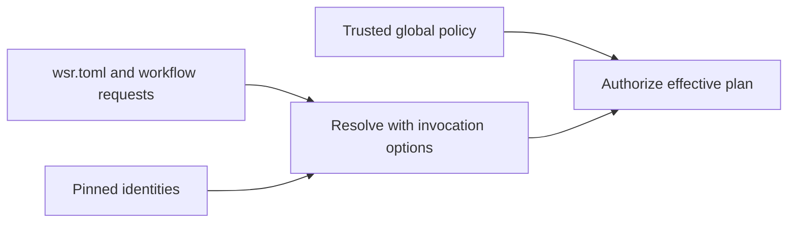

# Configuration, pins and repository metadata

## Status

D-023 selects root wsr.toml. Loading/generation remains unimplemented. D-029 records runner/tool
metadata direction. Examples of fields and file layouts remain proposals; source scaffold types
are not configuration schemas.

## Configuration ownership

| Scope | Content | Authority |
| --- | --- | --- |
| Repository wsr.toml | Parameters, provider selection, workflows, defaults, runner references | Requests and reproducibility settings |
| Repository pins | Exact provider/action/profile/package identities | Inputs to resolution, verified under trusted policy |
| Custom runner manifest | Platform/tools/defaults and company-package references | Requests subject to owner source/package policy |
| Trusted global policy | Grants, source trust, cache and device scheduling limits | Machine owner/administrator |
| Invocation | Workflow/event/input selection and permitted overrides | Subject to trusted policy |
| Generated state | Compiled models, resolved plans, run records | Local implementation state with access/retention rules |

Normal precedence is explicit invocation over applicable repository defaults over built-ins.
Trusted policy constrains the result. A repository may request lower resource use but cannot widen
device limits or grants. Global max-jobs=0 means no configured count cap, with other admission
checks still effective. Exact keys/locations and merge rules require specification.

## Init versus run

Init discovers workflows/providers, preserves existing config and pins, and performs provider
bootstrap under D-010. Proposed runner setup resolves/pins small manifests and stores references
rather than copying full inventories into wsr.toml. Run bootstraps missing configuration/provider
inputs when supported, then provisions only the selected invocation's required packages.
Explicit prefetch/preparation is a future interface choice.

Both paths verify reused objects. Normal approved downloads are progress, and YAML edits alone
produce no warning. Only blocked requirements/acquisition/enforcement produce actionable diagnostics.
An explicit offline acquisition policy fails on missing inputs, with no new CLI syntax implied.

## Proposed metadata layout

The owner has requested a repository metadata home. A candidate layout keeps wsr.toml and a lockfile
under version control while .wsr/state contains ignored compiled/planned/run data. Lockfile naming,
location, JSON/TOML formats and access controls remain open. Downloaded immutable packages live in
the shared host cache, not duplicated per repository. Raw secrets belong in credential provisioning.

Nine jobs need nine job records, not necessarily nine profiles. Jobs can share a profile, matrices
can expand target variants, and expressions may defer target resolution. Resolved plans reference
profile identities and preserve invocation-specific bindings. Regenerate derived metadata when
source/provider/compiler/configuration/input or relevant policy identities change.

## Open decisions

Specify schema versions, runner aliases/pins/inheritance, parameter binding, environment overrides,
lockfile update rules, global config location, policy/grant vocabulary, credential injection,
metadata recovery and daemon state ownership. TOML maintained profiles and JSON resolved manifests
are format proposals. See [provisioning](../provisioning/README.md), [cache](../cache/README.md) and
[policy](../policy/README.md).
