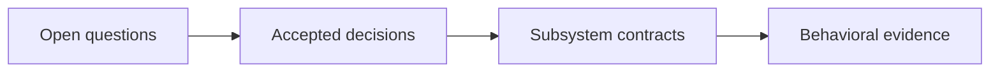

# wsr redesign plan

> Status: **pre-alpha design in progress; Java E2E implementation paused**
>
> This document is the durable record of the design feedback loop. Confirmed decisions,
> rejected alternatives, unresolved questions, and their consequences are recorded here as the
> conversation progresses. The [Java worker contract](../implementation/java-e2e.md) records the
> historical bounded slice; implementation requires explicit resumption. Unresolved architecture
> choices still require decisions.

## Documentation status and ownership

This is the authoritative product decision record. Accepted decisions describe planned behavior,
not implemented features. The current checkout is a CLI/workspace scaffold: `inspect` is
implemented as static workflow inspection (D-031) and the other command handlers remain placeholders. Substantial prototype work remains in a local stash, separately from current
source and completion accounting.

Use [ARCHITECTURE.md](architecture.md) for source inventory and target boundaries,
[CHECKLIST.md](status.md) for implementation status, [ROADMAP.md](roadmap.md) for delivery gates,
and [the security model](../security/README.md) for the accepted trust contract and open exceptions.
Organization docs summarize these records. Historical drafts do not override them.

Documentation can be made consistent while design questions remain open. The owner authorized the
bounded Java E2E worker on November 1, 2026; this does not authorize stash restoration, publication,
or silently selecting unresolved runtime/backend or policy contracts.
The later owner stop recorded in the [November 5 checkpoint](../implementation/java-progress.md#current-checkpoint--november-5-2026)
takes precedence. Documentation and metadata sanitization does not resume that worker.
The [crate inventory](../../crates/README.md#maintenance-dispositions--november-6-2026) records maintenance
dispositions and publication constraints without selecting new product interfaces or deleting packages.

## 1. Purpose

Design a from-scratch architecture and implementation plan for `wsr`. The design must not inherit
the current crate structure, runtime choices, compatibility claims, or roadmap without explicit
justification.

## 2. Confirmed product direction

### D-001 — Local-first, cloud-portable workflow execution

**Decision:** `wsr` will first provide an efficient and reliable way to execute GitHub Actions
workflows locally. The same system should later be deployable on infrastructure in any cloud.

**Product benchmark:** improve materially on `act`, especially where its container-based execution
is inefficient or unreliable. Reproducing GitHub's hosted control plane is not the initial goal.

**Architectural consequence:** workflow interpretation and execution must not depend on GitHub's
hosted service or on a particular cloud. Local execution is a real deployment target, not a test
double for a future cloud runtime.

**Still unresolved:** the meaning of “same system” across local and cloud, including which
components, protocols, artifacts, and semantics must remain identical.

### D-002 — Classified compatibility instead of a universal compatibility claim

**Decision:** Existing provider workflows are accepted through provider adapters. Compatibility is
reported per feature as native, faithfully emulated, fallback-required, unsupported, or unknown.
Unsupported and approximate behavior must be diagnosed rather than silently accepted.

**Architectural consequence:** compatibility analysis is a first-class compiler output. It is not
an incidental runtime error path.

### D-003 — Provider-agnostic core with a canonical workflow IR

**Decision:** GitHub Actions, GitLab CI/CD, Bitbucket Pipelines, and future systems enter `wsr`
through provider adapters. The execution core consumes a `wsr`-owned provider-neutral workflow
representation rather than provider YAML or provider-specific objects.

**Architectural consequence:** provider parsing, source semantics, expression languages, implicit
defaults, and diagnostic source locations belong outside the execution core. The canonical model
and its versioning are owned by `wsr`.

**Clarification resolved by D-004:** one source workflow produces one canonical workflow;
individual constructs may lower into zero, one, or multiple nodes. The former “1:1 mapping”
terminology question is not an outstanding decision.

### D-004 — Workflow-level mapping with construct-level lowering

**Decision:** One provider source workflow compiles into one canonical `wsr` workflow with complete
source traceability. Individual provider constructs may lower into zero, one, or multiple canonical
IR nodes.

**Rejected alternative:** requiring one canonical construct for every provider construct. That
would turn the provider-neutral model into an accumulating union of provider keywords and quirks.

**Architectural consequence:** adapters preserve provider source locations and provenance across
lowering. Semantics that cannot be represented canonically produce compatibility diagnostics or an
explicit fallback requirement; adapters may not pass opaque provider operations into the execution
core.

### D-005 — Common semantic kernel with controlled extensions

**Decision:** The canonical workflow IR models concepts shared across CI providers. Workflows,
jobs, steps, dependencies, conditions, variables, outputs, and similar concepts belong in the core
when provider research confirms a common semantic meaning.

Provider syntax is not copied directly into the core. An adapter lowers provider syntax into the
common model. Provider-exclusive behavior remains in the adapter when it can be expressed through
core concepts; behavior that cannot be expressed may require a controlled extension mechanism.

**Architectural consequence:** the IR is a semantic compatibility model, not the union of every
provider's YAML schema. Admission criteria for core concepts and runtime-visible extensions must be
defined before implementing adapters.

### D-006 — No cross-provider source translation

**Decision:** `wsr` will not export a workflow from one provider's syntax into another provider's
syntax. GitHub Actions to GitLab CI/CD and reverse translation are explicitly outside the plan.

**Preserved requirement:** every provider frontend must compile into the same canonical workflow
abstraction so the execution core remains provider-agnostic.

**Architectural consequence:** provider integrations are one-way compiler frontends. The canonical
IR needs semantic fidelity for validation and execution, but it does not need enough presentation
information to reconstruct target-provider YAML.

### D-007 — Rust trait as the provider frontend abstraction

**Decision:** provider integrations will implement a `wsr`-owned Rust trait that translates
provider input into the canonical workflow model and compatibility diagnostics.

**Architectural consequence:** the trait must depend on provider-neutral request, result, IR,
diagnostic, and capability types. It must not expose GitHub-, GitLab-, or Bitbucket-specific types
to the execution core.

**Clarification:** the Rust trait is the in-process host abstraction. A downloaded plugin cannot
directly become a Rust trait object because Rust crates are linked at build time and Rust trait
object layout is not a stable plugin ABI. A host-side trait implementation must delegate across a
separate stable plugin protocol.

### D-008 — Provider discovery and first-use plugin installation

**Decision:** the stock `wsr` binary reads repository configuration from root `wsr.toml` and
discovers provider workflow files. `wsr init` creates this configuration with GitHub Actions as
the primary provider (D-023). During repository setup, it resolves and installs the corresponding
official precompiled provider plugin
when it is not already available. For example, discovering `.github/workflows` selects the official
GitHub Actions provider.

Provider installation also occurs when `wsr` is reinstalled or reinitialized for a repository as
needed. Normal execution uses the installed, verified provider artifact rather than rebuilding a
Rust crate.

**Required lifecycle:** discover, resolve, fetch, verify, install/cache, connect through the host
provider abstraction, then compile the repository's workflows.

**Architectural consequence:** provider identity, protocol compatibility, artifact platform or
runtime compatibility, version selection, integrity verification, trust policy, cache location,
repository pinning, upgrades, offline behavior, and recovery from failed installation are product
requirements—not incidental download details.

**Boundary resolved by D-009:** providers use signed WebAssembly Components with a versioned WIT
contract. Native executable/IPC and dynamic-library/C-ABI formats were earlier candidates,
not outstanding alternatives for the accepted provider plugin boundary.

### D-009 — WebAssembly Component provider plugins with a WIT boundary

**Decision:** downloadable providers are signed WebAssembly Components implementing a versioned
WIT provider contract. Provider authors may implement a component in Rust or another supported
language; the installed artifact is a component, not a dynamically linked Rust crate.

The host contains a `ComponentProvider` implementation of the internal Rust provider trait. It
delegates provider operations across WIT to the selected component.

**Architectural consequence:** the WIT contract, canonical data encoding, protocol negotiation,
component resource limits, and host capability grants form a security and compatibility boundary.
Provider components receive no ambient filesystem, network, environment, credential, or secret
access. Required inputs are passed explicitly by the host.

### D-010 — Repository bootstrap and reproducible provider activation

**Decision:** repository-aware commands bootstrap providers when necessary:

1. find the repository root, read `wsr.toml` when present, and read existing provider pins;
2. discover provider fingerprints using logic built into the host;
3. resolve the official plugin compatible with the host protocol;
4. download to staging, verify identity, digest, and signature, then install atomically;
5. store the artifact in a shared machine cache and pin its exact identity for the repository;
6. instantiate it through `ComponentProvider`, compile workflows, validate the result, and continue
   with the requested command.

`--help` and `--version` never scan or download. `init` performs bootstrap explicitly; repository
commands such as `run` and `inspect` may bootstrap an uninitialized repository. Provider upgrades
are explicit. A cache hit for the pinned artifact requires no network access.

Official providers may be installed automatically with visible progress after discovery.
Third-party providers require explicit approval. Missing artifacts in offline mode fail with a
specific remediation rather than selecting an unpinned version.

### D-011 — Multiple providers are supported without implicit selection

**Decision:** one repository may configure multiple providers in `wsr.toml` and install and pin
those providers. The pin/lock schema and location remain open (D-023).
An explicit provider selection or unambiguous workflow path selects the provider for an invocation;
otherwise the configured primary provider supplies the repository default (D-023). If these inputs
conflict or selection remains ambiguous, `wsr` reports the problem rather than guessing. A primary
provider is a repository choice, not a restriction on installing or selecting other providers.

### D-012 — Provider plugins terminate at the compilation boundary

**Decision:** provider plugins parse provider expressions, apply provider defaults, classify
evaluation phases, and lower expressions into a canonical expression IR. They are not called during
workflow planning or execution after compilation succeeds.

The provider-neutral core owns deterministic evaluation at the appropriate phase, including event
and input binding, matrix expansion, job conditions, step conditions, status functions, and values
derived from completed step or job outputs.

**Architectural consequence:** a compiled workflow and its execution bundle contain no opaque
provider expressions or runtime callbacks into a provider component. Unrepresentable expressions
produce a declared extension requirement or compatibility diagnostic.

### D-013 — Shared content-addressed cache is a core subsystem

**Decision:** `wsr` maintains a central per-user cache shared across repositories. Repositories pin
logical identities and exact versions or digests; immutable content is stored once and reused by
every repository with matching requirements.

Candidate cache object classes include:

- verified provider components and provider metadata;
- resolved action sources and immutable action artifacts;
- compiled action components or other execution artifacts;
- compiler outputs such as canonical IR snapshots and execution bundles;
- runtime and toolchain artifacts required by compatibility backends;
- provider schemas and safely cacheable resolution metadata.

**Correctness requirement:** derived-object keys include all inputs that can affect output, such as
source digest, provider identity and version, compiler version, target, configuration, feature set,
and relevant policy version. A cached result must never be reused merely because two repositories
have the same filename.

**Security boundary:** secrets, credentials, raw secret-bearing event payloads, mutable run state,
and unredacted logs are not stored in the shared content-addressed cache. Verified and unverified
artifacts occupy distinct trust states and cannot alias.

**Required operations:** inspect, verify, garbage-collect, repair, and explain why an object is
retained. Installation and writes are staged and atomic. Repository pins act as roots for retention
and reproducibility; cache deletion must not silently change the selected version.

### D-014 — Local cache only for the MVP

**Decision:** the MVP implements a per-user, filesystem-backed cache shared by local repositories.
Remote, team, and cloud cache services are deferred until the local content store proves its
correctness, locking, integrity verification, garbage collection, repair, and trust separation.

**Future-proofing boundary:** cache consumers depend on a narrow content-store abstraction rather
than filesystem paths. This preserves the option to add a remote backing store later without
requiring an MVP network protocol or distributed consistency model.

### D-015 — Tiered execution with WebAssembly preferred and compatibility fallbacks

**Decision:** the planner classifies workflow operations by execution requirements. Native
WebAssembly execution is preferred. When semantics or dependencies cannot run there, `wsr` selects
a compatible backend such as a JavaScript runtime or an OCI/container backend. D-024 selects Bun
for compatible GHA JavaScript actions; this does not select the system isolation substrate. Docker is avoided
when possible but remains available for workflows that genuinely require container semantics.

The tier system is capability-based rather than provider-based: the same workflow may contain
operations with different compatibility classifications. Each classification is visible during
inspection and planning.

**Resolved by D-016:** tier selection precedes side effects, with no automatic replay after
partial execution; jobs use supervision with separate step environments.

**Unresolved:**

- the exact MVP backends and whether OCI support ships in the first milestone;
- how requested operating-system and architecture labels map to local host, container, VM, or later
  remote runners.

**Feedback after initial job-promotion proposal:** promoting every step to the strongest backend
required by any step would unnecessarily widen privileges and reduce step isolation. The design
must distinguish a job's shared compatibility substrate from each step's least-privilege sandbox.
The replacement is a job supervisor plus ephemeral per-step environments.

### D-016 — Job supervisor with least-privilege per-step environments

**Decision:** the job is a controlled state and lifecycle boundary, not a single execution tier.
Every step is classified before execution, receives its own least-privilege environment, executes
once, exports permitted state through host-mediated channels, and is destroyed. A step requiring
OCI does not promote unrelated steps to OCI.

The job supervisor owns the workspace state, environment and path updates, step and job outputs,
toolchain state where required, services, cancellation, and timeouts. It exposes only the relevant
views and capabilities to each step environment.

**State rule:** step isolation applies to processes, secrets, capabilities, scratch space, and
unshared filesystem or network access. Workflow-declared shared state remains observable by later
steps. Changes cross the boundary through explicit mounts, snapshots/diffs, environment files,
output channels, artifact operations, or other audited host interfaces.

**Fallback rule:** tier selection completes before a side-effecting step begins. `wsr` does not
automatically replay a partially executed step in a more permissive backend.

**Platform constraint:** Linux containers share a Linux kernel and can provide different Linux
userlands, but they do not provide faithful Windows or macOS execution. True cross-OS matrices
require matching native hosts, virtual machines where legally and technically available, or later
remote runners.

### D-017 — Independent local execution and optional integrations

**Decision, refined November 5, 2026:** WSR owns local workflow execution without GitHub
registration, scheduling, or control-plane availability. Existing GHA workflows are source inputs.
With all required inputs cached and a workload that needs no external services, execution can
proceed disconnected. Default approved acquisition fills missing cache objects as ordinary progress.
YAML edits alone produce no warning or notification. D-027 owns exact cache/offline behavior.

Running the same engine inside GitHub Actions and publishing results to GitHub are optional
integrations. Reporting outages must preserve local execution results. Remote CI hosting and
worker fleets remain separate later scope. Attestation trust and publication are specified
separately from execution under D-030.

This refines the earlier local-then-hosted delivery order. Local execution independence is the
core requirement; GitHub reuse does not gate it. Wrapper selection, credentials, reporting,
cancellation ownership and recursion prevention remain open integration contracts.

### D-018 — Component Model as a core security boundary

**Decision:** the WebAssembly Component Model is central to the product's deny-by-default
execution model, not merely an optional performance optimization. Concrete runtimes, WASI
versions, and the initial system compatibility backend remain open choices.

**Architectural consequence:** components interact with the outside world through explicit,
typed imports. Under the default policy, the host supplies no ambient filesystem, network, environment, credential,
secret, or native-process authority. Requested capabilities are granted only within policy
authorized by the machine owner or CI administrator; an untrusted workflow cannot authorize
itself. Grants must also account for composed components and authority passed between them.

**Security scope:** the Component Model defines interfaces; the runtime and host must enforce
the restrictions. A broadly privileged host function can undermine the intended boundary.
Component containment does not automatically constrain a native process launched by the host,
and signatures or content digests do not establish that a component is safe.

**Compatibility consequence:** shell commands, existing JavaScript actions, compilers, and
package managers are not assumed to become components automatically. Their execution requires
a separately defined security contract. A component wrapping a native command must not be
reported as giving that command component-level containment.

**Validation requirement:** security claims require negative tests demonstrating denied access
as well as positive tests demonstrating authorized operations. The contract must cover resources,
state shared between steps, and secrets in addition to typed interface compatibility.

**References:** [Component Model interfaces and composition][component-model];
[WebAssembly sandboxing and WASI capabilities][wasmtime-security]. These establish the design
mechanisms, not verification of WSR's unimplemented host.

[component-model]: https://component-model.bytecodealliance.org/design/why-component-model.html
[wasmtime-security]: https://docs.wasmtime.dev/security.html

### D-019 — Isolated system execution with explicit grants and fail-closed admission

**Decision:** ordinary shell steps and native tools may execute through an isolated system
backend with explicit capability grants. If the selected backend cannot enforce the required
restrictions, WSR rejects execution. A component-only launch and an unrestricted native mode
are not the selected default contract. D-022 adds an explicitly authorized broad-access profile;
it does not authorize an automatic downgrade when this default contract cannot be enforced.

**Admission rule:** the planner matches required OS/architecture, job-state semantics, isolation,
and requested capabilities against the backend's enforced capabilities. Policy authorizes grants;
the backend must enforce the remaining denials. A missing enforcement feature is an actionable
diagnostic, not an implicit permission grant or downgrade. Unsupported steps block admission of
the selected execution plan before repository-controlled code runs.

**Enforcement scope:** filesystem views and writable paths, networking, environment and secrets,
processes and descendants, host/daemon access, and resource/lifecycle limits must be specified.
Clearing environment variables, setting a working directory, or wrapping a command in a component
does not establish this isolation. Containers or VMs are implementation candidates, not evidence
that a particular configuration satisfies the contract.

**Job state:** D-016 still applies. Shared workspace, tools, outputs, and services have explicit
lifetimes and access rules; a grant to one step does not automatically authorize later steps.
Shared files can carry malicious state, so process isolation alone does not establish independent
trust between steps.

**Validation requirement:** test permitted operations and attempts to access ungranted files,
network endpoints, credentials, processes, and host interfaces. Verify descendant cleanup on
timeout/cancellation and rejection when an enforcement capability is unavailable. Document the
tested platform/backend combinations and their residual trust assumptions.

**Still unresolved:** concrete backend, policy/grant format, and enforceable resource and network
restrictions. Initial execution platforms are resolved by D-020; the threat model by D-021.

### D-020 — Linux jobs from macOS and Linux machines first

**Decision:** the first release supports local development on macOS and Linux machines while
executing Linux jobs. Native macOS and Windows jobs are deferred.

**Architectural consequence:** the CLI host OS and a job's execution OS are distinct. On macOS,
Linux system jobs require a VM-backed Linux environment. On Linux, the concrete isolation backend
remains to be selected under D-019. The Component Model's security contract still governs
component operations regardless of the CLI host OS.

**Compatibility rule:** a Linux environment does not satisfy a workflow requesting native macOS
or Windows behavior. Unsupported platform requirements must be diagnosed rather than silently
rewritten as Linux jobs.

**Still unresolved:** supported host/job CPU architectures and any emulation policy, VM/container
runtime selection, environment provisioning, image/toolchain identity, and enforcement parity
between macOS-hosted and Linux-hosted execution. Linux OS support alone does not establish
equivalence to GitHub's hosted runner images.

### D-021 — Malicious workloads on a single-user machine

**Decision:** the first release assumes repository code, workflow definitions, third-party
actions, dependencies, and build scripts may deliberately attempt to steal credentials or
access resources outside their grants. The initial deployment is a single-user machine;
hostile multi-tenant remote execution is deferred.

**Protected assets:** host files and credentials outside grants, host services and runtime control
interfaces, WSR policy and enforcement state, other runs' private state, and machine availability
within declared resource limits. All inputs originating from a workload, including paths,
archives, logs, artifacts, and claimed results, must be treated as untrusted at host boundaries.

**Authority rule:** a workload cannot change the owner-approved policy, turn its capability
requests into grants, acquire inherited host credentials, or silently widen a denied capability.
Trust in a source repository or a component signature does not bypass enforcement.

**Security limits:** granted access remains access. A malicious operation that legitimately
receives source data and an outbound channel may leak that data; an endpoint allowlist alone
does not prevent this. WSR cannot establish truthful test results or trustworthy artifacts merely
by containing the program that produces them. The design must document trusted host/runtime
components, shared-state risks, authorized data flows, and residual vulnerability assumptions.

**Validation requirement:** use adversarial fixtures, not only accidental permission failures.
Include host-file and credential probes, attempts to reach host services or control sockets,
path/symlink/archive traversal, poisoned shared state, resource exhaustion, and descendant
processes surviving termination. Reject unsupported enforcement requirements before execution.

**Still unresolved:** the outer isolation boundary for system jobs, boundary lifecycle and reuse,
and whether a dedicated CI environment can satisfy that boundary without another nested VM.

### D-022 — Explicit broad-access compatibility profile

**Decision:** retain deny-by-default execution as the default while offering an explicit opt-in
profile or wildcard parameter for broad runner access. This supports workflows that need more
authority than the default policy allows. Exact syntax and wildcard scope remain unresolved.

**Authority rule:** the machine owner or CI administrator authorizes this profile through a trusted
invocation or policy. A workflow may request it but cannot enable it merely by editing repository
configuration. A permission denial or backend failure must not activate it automatically.

**Proposed scope, awaiting confirmation:** full workload access inside the managed Linux runner
environment, while preserving the boundary to the personal host and WSR's policy/control
interfaces. Credentials remain those explicitly provisioned for the execution; a wildcard does
not discover host credentials, grant GitHub token scopes, or bypass GitHub's secret-release rules.

**Security consequence:** the broad profile gives up the narrower least-privilege guarantees
within its authorized scope. Reports must identify the effective profile and grants. The default
profile's malicious-workload containment claims must not be attributed to a broader grant set.
Remaining restrictions, including any retained outer boundary, still require enforcement.

**Compatibility limit:** broader permissions remove permission-related barriers; they do not
implement missing action protocols, expressions, OS/toolchain behavior, or GitHub-hosted services.
Component imports also remain limited to implemented host interfaces. A wildcard is not a promise
of complete GitHub Actions compatibility or automatic conversion of native programs to components.

**Validation requirement:** prove the default still denies broad access, repository input cannot
self-enable the profile, activation stays within its declared scope, and the effective grants
are reported. Compatibility tests remain separate from permission-grant tests.

**Still unresolved:** wildcard scope, parameter/profile naming, activation granularity (step,
job, or selected pipeline), and the outer isolation decision in Q-020.

### D-023 — Root TOML configuration and repository defaults

**Decision:** `wsr init` creates `wsr.toml` at the repository root. This is the repository-owned
configuration for parameters, configured providers, the primary provider, workflow discovery,
and sensible invocation defaults. GitHub Actions is the primary provider in a newly initialized
configuration; other providers may be configured and explicitly selected. Local execution remains
the default product path. Existing configuration and provider pins must be preserved on reinitialization.

**Resolution rule:** explicit invocation options override applicable `wsr.toml` settings;
repository settings override documented built-in defaults. Provider/target options in the CLI
proposal are overrides, not arguments that users must repeat for each command. A workflow provider
interprets source syntax; an execution destination selects local execution or a hosted integration.
Selecting a provider does not by itself select a remote destination.

**Trust boundary:** repository parameters, defaults, and capability requests do not authorize
access. Trusted owner or CI-administrator policy remains authoritative, including approval of
third-party providers and broad-access profiles. Raw secret values are not repository configuration.
Effective settings and their sources should be explainable without revealing secrets.

**Current status:** configuration loading/generation is not implemented; `init` still returns the
standard placeholder diagnostic. The preserved prototype's `wsr.json` is historical work, not the
selected configuration format. This decision does not authorize restoring that prototype.

**Still unresolved:** exact TOML keys and schema versioning, parameter types and binding,
provider pin/lock schema and location, environment-variable overrides, trusted policy location,
credential provisioning, and the CLI structure for inspecting or changing configuration.

### D-024 — GHA compatibility through Bun

**Decision (2026-11-01):** retain the provider adapter and provider-neutral core. GitHub Actions
compatibility design lives in [wsr-gha](../provider/gha/README.md). Use Bun as the intended runtime
for compatible GHA JavaScript actions inside the separately isolated system backend. The provider
lowers source semantics and explicit execution requirements; core planning, authorization, supervision,
and backend enforcement remain shared. Provider compilation does not execute actions.

**Execution model:** prefer compatible component artifacts where available; use Bun for qualified
JavaScript actions and explicit shell/tool/container paths for their respective requirements. This
is not a fixed three-tier ladder. QuickJS is not required. No native Node fallback is selected, and
no JavaScript-to-Wasm conversion or universal Node compatibility is assumed. Backend selection
precedes side effects; failures never trigger automatic replay with broader grants.

**State:** D-016 remains authoritative. The provider owns GHA environment/output/action-state
semantics; the supervisor owns shared workspace and resource lifetimes. No overlay/VFS mechanism
is selected. Bun and descendants require system isolation; Bun is not a sandbox boundary.

**Open:** Bun version and provisioning/integrity, initial API/action subset, optional executable
bundling, lifecycle and command-protocol lowering, canonical requirements/extension admission,
component artifact mapping, system/container substrate, and precise state/failure semantics.
A selected runtime family does not settle its backend or prove compatibility.

**Pre-alpha status:** all execution paths remain unimplemented. These documents may change by commit;
they do not freeze APIs or serialized contracts. Record subsequent decisions here and update the
provider contract and evidence together. See [GHA validation](../provider/gha/validation.md).

### D-025 — Verified tool preflight before workflow execution

**Decision:** after provider compilation, WSR inventories statically identifiable commands,
action runtimes, declared tool versions and system/library dependencies for the selected job
OS and CPU architecture. Before any workflow-controlled step executes, host provisioning
resolves those requirements against supported tools, verifies eligible immutable cached
packages, and fetches approved missing packages with their dependency closure. Downloads are
staged, verified under trusted source/integrity policy and published atomically. The job receives
a controlled tool view and PATH. Record exact package, dependency, target and verification identities.

Known unsupported tools, incompatible versions/targets, unverifiable packages or denied
acquisition reject the selected workflow invocation before execution, with source-linked
diagnostics and remediation. Cache presence grants no execution authority. Cache provenance,
allowed sources, retention and quotas are controlled separately from step execution grants.

Preflight is an internal plan phase with visible progress/failures. It preserves original
workflow step identities, ordering, conditions and outputs. Setup actions retain their declared
effects and requested versions. Provider compilation remains free of workload execution.

**Discovery limits:** arbitrary scripts and dynamic commands cannot be completely inventoried
by parsing YAML alone. Unresolved external tool requirements need an explicit supported declaration
or resolution contract before admission; the initial subset must reject unresolved requirements
rather than claim complete discovery. Executables produced by workflow build/setup steps require
an explicit execution policy and are not automatically unsupported catalog tools. No automatic
installation/replay follows a failed side-effecting command. Exact interfaces remain open.

**Initial admission boundary:** requirements dependent on unavailable job/step outputs are
rejected before any workload executes unless all possible required tools/targets can be resolved
and authorized in advance. Runtime selection among already admitted alternatives is allowed only
under a defined supported contract. Staged admission that discovers new external requirements
after earlier jobs execute is a future proposal, not the initial preflight guarantee.

**Baseline proposal:** evaluate a pinned subset of uutils/coreutils as bundled runner tools,
qualified per command against required GNU/GHA behavior. Shells, Git, curl and other tool families
need separate provisioning. Bundled tools remain subject to execution policy. Package/catalog
format, dependency resolver, baseline subset and packaging remain undecided.

**GHA reference:** consult the [runner image index](https://github.com/actions/runner-images#available-images)
and [Ubuntu 24.04 inventory](https://github.com/actions/runner-images/blob/main/images/ubuntu/Ubuntu2404-Readme.md).
Moving labels such as ubuntu-latest require recording the resolved image release and architecture.
Inventory entries inform compatibility work; supported packages still require qualification.

**Validation:** cover verified cache hits, approved misses, corrupt-package rejection, complete
dependency resolution, target/version mismatches, and unsupported/unresolved-tool rejection
before any workload step executes. Verify preservation of setup-action and step/output semantics.
This decision is planned behavior; provisioning remains unimplemented.

### D-026 — Repository observability and shared resource monitoring

**Decision:** logs, events and attributed resource metrics carry repository/workflow/run/job/step
identities and repository access boundaries. A separate device monitor measures shared capacity
and pressure. Cross-repository correlation requires explicit owner visibility policy. Record
resource budgets, queue waits and their admission reasons alongside CPU, RAM and available
I/O/process measurements, with scope, units and sampling gaps. Separate observed contention
from inferred causes and avoid double counting shared runtime/VM measurements.

See [Observability](../observability/README.md) for collection diagrams, a synthetic two-repository
resource timeline, privacy/retention requirements and acceptance gates. Storage, collectors,
sampling, UI and export mechanisms remain open. This is planned behavior, not implementation.

### D-027 — Cached execution and routine acquisition

**Decision:** normal invocations reuse verified exact pinned objects without an upstream
availability check. Approved missing providers, actions, tools and dependencies are fetched and
verified automatically. Changed YAML invalidates affected derived plans and resolves new
requirements through the same path. Downloads are progress; unsupported requirements, unavailable
objects, acquisition failures, integrity failures or denied access are actionable diagnostics.
Distinguish network/authentication/rate-limit failures from confirmed upstream unavailability.

Offline execution reuses inputs and executes jobs again; it does not restore prior test success.
When acquisition is disabled, a missing required object blocks admission with preparation guidance.
Workload-required network services remain dependencies. Offline CLI syntax remains open.

A matching verified cached action can execute after upstream deletion. Retained repository pins
root objects for normal cache collection. Explicit forced removal may break future offline runs
and must explain that consequence. Upgrades are explicit; never replace a missing pin silently.
Known local revocations override cache eligibility. Any freshness requirement for remote revocation
information is explicit policy, with offline freshness recorded. No continuous monitoring is required.

### D-028 — Device scheduling and repository isolation

**Decision:** ready jobs across repositories are subject to one global admission policy. The
job-count policy (max-jobs) is superseded by D-032's memory budget: concurrency follows from the
memory the user allows, not from a configured count. Dependency-blocked jobs are distinct from ready queued jobs.
Platform, policy and resource admission still apply. Record queue reasons for observability.
Completion/cancellation releases its admitted memory after supervised cleanup; exact admission and crash
reconciliation contracts must be settled before implementation.

Scheduling chooses eligible jobs; dispatch allocates a qualified environment and starts their
supervisors. Shared cached packages do not imply shared mutable workspaces, credentials or logs.
An optional per-user coordinator/daemon, foreground ownership, fairness, persistence, resource
budget policy and IPC authentication remain proposals requiring contracts. Core workflow semantics
must be shared between modes. This decision does not prescribe time-slicing or job preemption.

### D-029 — Runner profiles, package catalogs and repository metadata

**Direction:** separate runner environment descriptions from package acquisition metadata. A
runner profile describes target platform/ABI, defaults, tools, environment and execution facilities.
A package describes exact identity, sources, verification, dependencies and activation. Custom
company profiles/tools remain subject to trusted policy. No automatic recompilation of actions is
selected. uutils remains an evaluated baseline proposal under D-025.

**Open schema proposals:** maintained TOML profiles, generated JSON resolved manifests, inheritance,
profile references in wsr.toml and committed pins under .wsr with ignored local state. No field
names, lockfile location or profile serialization are approved by these examples. Proposed init
behavior resolves/pins small manifests; run provisions only required tools. D-010 provider
bootstrap remains applicable, including uninitialized invocations. See the config and provisioning
guides for responsibilities and outstanding decisions.

### D-030 — Local evidence and optional attestations/reporting

**Direction:** collect local results and input/environment/artifact identities independently of
external publication. Signing/attestation and GitHub connectors are optional capabilities. Preserve
local results during reporting outages and expose publication status separately from execution.
Attestations bind a signer to claims; trust, truthful execution, key protection and verification
require explicit contracts. Attestations do not automatically satisfy GitHub required checks.

Attestation format, signer trust policy, key custody, queue/retry persistence, remote API mapping
and receiver configuration remain open. Workloads cannot access signing keys or invent authoritative
host evidence. Only explicit user-configured connectors may publish externally.

### D-031 — Temporary built-in compiler for local inspection

**Decision (November 6, 2026):** the owner authorized option 1 of the inspection prerequisite
review: temporarily link the GHA compiler into the host for explicit local-file inspection.
This is a scoped exception to the Component-only activation path in D-007/D-009/D-010, not a
replacement of the target architecture. It does not authorize workflow execution or resuming
the paused Java worker.

Keep parsing and validation in `wsr-gha`, temporary GHA-derived source summaries in `wsr-types` (D-033), and
file IO/rendering in the CLI host. Do not reinterpret legacy `WorkflowIR` as the accepted model.
These summaries are not executable plans or a stable serialized protocol. Reject unsupported
inputs explicitly; do not infer execution compatibility from a successful inspection.

The compiler and its acceptance fixtures must be reusable when packaged as a signed Component.
Component migration still requires WIT, trust, identity/pinning and resource-limit contracts.
Inspection through this temporary path does not load repository configuration, bootstrap providers,
fetch actions/tools, execute repository commands or mutate repository state.

### D-032 — Memory-budgeted job concurrency aligned with `ubuntu-slim`

**Decision (November 13, 2026):** the owner sets one total memory budget for jobs instead of a
parallel job count. The default and minimum budget match GitHub's `ubuntu-slim` runner (5 GB, one
job at a time). Larger budgets admit as many concurrent jobs as fit; larger runner profiles (D-029)
may be added later.

Each job has a 5 GB ceiling matching `ubuntu-slim`. The ceiling is a limit, not a reservation:
nothing is set aside up front. A job is admitted when its expected use fits in the remaining
budget; expected use is the measured peak from earlier runs (D-026) or a small default for a first
run. The budget is a hard limit across running jobs. Under memory pressure, admission holds new jobs;
if the budget is exceeded, the most recently started job is stopped, requeued and reported. A job
exceeding its own ceiling is stopped alone. On macOS, Linux jobs run in a VM (D-020), so the budget
maps to the VM's memory size.

WSR imposes no workflow file-size limit. A workflow file over GitHub's documented 500 KB limit
produces a warning that GitHub would not run it; inspection continues. Local inspection measured about
6× the file size plus 5 MB of memory, inside the same budget; serde_yaml rejects alias-expansion bombs.

Enforcement requires the isolation backend selected under Q-020. Until then these are documented
targets, not guarantees. Exact admission defaults, accounting and crash reconciliation remain open.

### D-033 — GHA-derived inspection summaries stay temporarily in `wsr-types`

**Decision (November 13, 2026):** DR-002 option 1. The D-031 inspection types in
`wsr_types::inspection` (manual triggers, dispatch input types, run-name, the `${{` fence) are
labelled temporary GHA-derived source summaries, not provider-neutral model types. Further D-031
inspection fields may be added there under the same label. The neutral model is settled with
queue items 7 and 9 (canonical IR stability and source/translation stages); this decision does not
freeze these types as canonical IR.

### D-034 — Roadmap Gate 1 split

**Decision (November 13, 2026):** DR-004 option 1. Gate 1 splits into 1a, D-031 static inspection,
which can be completed and verified independently, and 1b, Component compilation and planning, which
depends on the pin schema, the canonical-IR boundary and the Component host contract.

## 3. Superseded or unconfirmed prior claims

The following ideas found in the existing repository are not requirements unless this plan later
accepts them explicitly:

- A promise of 100% GitHub Actions compatibility.
- Wasmtime, WASI Preview 3, Wasmer, or WASIX as predetermined runtime choices.
- Automatic conversion of JavaScript actions to WebAssembly.
- A two-tier “Vault / Workshop” execution model.
- One sandbox instance per step.
- Git hooks and a background daemon as the primary product experience.
- The existing 16-crate workspace boundary.
- GitLab CI and Bitbucket Pipelines as the next provider priorities.
- A separate distributed execution project or service named `wkube`.
- A prohibition on every possible container-backed compatibility path.

## 4. Design principles accepted so far

- Begin with user-visible compatibility and reliability, then derive internal boundaries.
- Keep provider syntax outside the provider-neutral execution core.
- Treat local execution as the first end-to-end milestone.
- Execute locally independently of GitHub; add hosted reuse and reporting through optional integrations.
- Make the Component Model and explicit capability grants central to the security contract.
- Reject system execution when the chosen backend cannot enforce the required restrictions.
- Target Linux jobs from macOS and Linux development machines before native macOS/Windows jobs.
- Design for malicious workloads on a single-user machine, with explicit trusted boundaries.
- Allow owner-authorized broad runner access as an explicit exception to the default policy.
- Preserve a path to cloud execution without requiring cloud infrastructure for local use.
- Make unsupported or approximate behavior visible; never silently claim equivalence.

## 5. Architecture decision queue

Questions are resolved in dependency order, one at a time:

1. ~~GitHub Actions compatibility contract.~~ Resolved by D-002.
2. ~~Meaning and scope of multi-provider support.~~ Resolved by D-003 and D-004.
3. ~~Meaning of adapter “1:1 mapping” and preservation of provider semantics.~~ Resolved by D-004.
4. ~~Cross-provider translation.~~ Rejected by D-006.
5. ~~Provider plugin ABI and artifact format.~~ Resolved by D-009.
6. Core-versus-extension admission policy for provider-exclusive behavior.
7. Stability and serialization boundary of the canonical workflow IR.
8. ~~Expression ownership across compilation and execution.~~ Resolved by D-012.
9. Remaining source representation and translation stages.
10. Action compatibility taxonomy (`run`, JavaScript, composite, Docker, local, reusable workflow).
11. ~~Tier selection timing and job-versus-step execution granularity.~~ Resolved by D-016.
12. Execution substrate and concrete compatibility backends (Bun selected for compatible GHA JavaScript actions by D-024; versions and isolation remain open).
13. Local/cloud portability boundary and execution protocol.
14. Workspace, filesystem, artifact, output, and service-container semantics.
15. Capabilities, permissions, secrets, identity, and supply-chain trust.
16. Scheduling mechanisms, matrices, cancellation, retry and failure semantics (memory-budgeted admission in D-032).
17. Observability mechanisms and evidence/signing contracts (directions recorded in D-026 and D-030).
18. Extensibility and versioning policy for providers, actions, IRs, protocols, and plugins.
19. CLI/product workflows and migration from GitHub Actions or `act`.
20. Crate/module boundaries derived from the accepted architecture.
21. Vertical milestones, tests, compatibility corpus, and completion criteria.
22. Documentation set and architecture decision records.

## 6. Open decision

### Q-020 — Outer isolation for system jobs

Q-017 is resolved by D-019: system execution requires explicit grants and rejects execution
when restrictions cannot be enforced. The platform portion of Q-018 is resolved by D-020:
Linux jobs from macOS and Linux hosts first. Q-019 is resolved by D-021: workloads may be
deliberately malicious on a single-user machine.

Next, decide whether system jobs require a VM boundary from a developer's personal host on both
macOS and Linux, or whether a hardened container sharing the Linux host kernel is acceptable.
Per-step capability enforcement remains necessary inside either environment.

The GitHub Actions integration also needs a boundary qualification contract: a dedicated,
disposable CI VM may be a candidate outer boundary, but its lifecycle, resident credentials,
WSR control state, and step enforcement must be evaluated. It must not be assumed equivalent
merely because the runner is called a VM. Nested virtualization must not become an unexamined
requirement for engine reuse in GitHub Actions.

Current recommendation: require a VM outer boundary for system jobs on developer machines,
then explicitly qualify dedicated CI environments. This is a proposal, not an accepted decision.

D-022 adds an explicit broad-access profile. Its wildcard scope must be resolved separately:
broad access within a managed runner does not by itself decide whether the personal-host boundary
is a VM or a hardened container. The proposed runner-only scope is awaiting user confirmation.

**Research constraints:** containers share their execution host's kernel; VM boundaries add a
separate guest kernel but do not replace capability enforcement or safe host interfaces.
GitHub documents nested virtualization as experimental and not officially supported.
See [containers versus VMs](https://docs.docker.com/get-started/docker-concepts/the-basics/what-is-a-container)
and [GitHub-hosted runner limitations](https://docs.github.com/en/actions/concepts/runners/github-hosted-runners).

Deferred:

- whether the canonical IR itself is a stable serialized contract or lowers into a separate stable
  execution protocol;
- final admission rules for core concepts and provider extensions;
- whether source comments and formatting require preservation for diagnostics and edits.

## 7. Implementation plan

To be written only after the architecture decisions above are resolved.

## 8. Validation and reader test

Before this plan becomes implementation-ready, it will be checked for hidden assumptions,
contradictions, underspecified interfaces, infeasible compatibility claims, and whether a fresh
implementation agent can identify the first vertical slice without conversational context.
