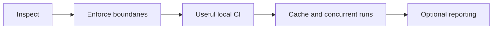

# wsr delivery roadmap

This is a staged direction, not a release/version schedule. [PLAN.md](decisions.md) owns decisions;
[CHECKLIST.md](status.md) owns implementation status. Creating a crate or writing a design does
not complete a runtime milestone. All execution milestones below remain planned.

## 0. Reconcile evidence and decisions

Preserve and inspect the July 29 prototype in an isolated recovery checkout. Record what compiles,
which tests run, what can be retained, and which assumptions conflict with the accepted design.
Resolve the first compatibility subset, security backend, wildcard scope, platform architectures,
and component host contract before calling a slice implementation-ready.

**Gate:** one coherent specification and recovery report; original stash retained. Documentation
can be synchronized before every design choice is resolved, provided open choices stay explicit.

## 1. Explain a workflow without executing it

D-034 splits this stage into two gates.

### 1a. Static inspection (D-031)

Inspect explicit local GHA files through the temporary built-in compiler: deterministic source
summaries, source diagnostics, explicit unsupported/dynamic classification, and the GitHub 500 KB
warning (D-032), with no execution.

**Gate:** the dogfood `example-*.yml` workflows inspect with expected output and inspection executes
no repository-controlled commands.

### 1b. Component compilation and planning

Connect provider discovery/pinning and the compilation boundary to deterministic inspection,
source diagnostics, a minimal canonical model, and plan validation. Classify unknown or unsupported
behavior instead of silently discarding it. Define evaluation phases for dynamic expressions.

**Gate:** representative fixtures produce expected diagnostics and plans; invalid plans are rejected;
inspection executes no repository-controlled commands. This compilation/planning gate remains unmet.

## 2. Prove component security

Choose a runtime/WASI baseline and a minimal versioned WIT contract. Execute one useful component
with explicit grants, input identity, bounded resources, and structured results.

**Gate:** permitted behavior works and adversarial attempts at ungranted access fail. Runtime and
host assumptions are documented; signatures are not treated as proof of safe behavior.

## 3. Prove isolated Linux system execution

Select a backend for Linux jobs from macOS and Linux machines. Specify workspace/tool/service state,
filesystem/network/process restrictions, secrets, resource limits, and cleanup. Implement default
policy and the explicitly authorized broad-access exception within its eventual approved scope.

**Gate:** adversarial probes and timeout/cancellation cleanup pass; unavailable enforcement blocks
execution; workflow edits cannot grant permissions to themselves. Native macOS/Windows jobs are rejected.

## 4. Deliver useful local CI

Combine compilation, validation, verified tool provisioning, qualified execution paths, job supervision, and results for a small tested
workflow. Expand dependencies, expressions, outputs, matrices, and actions only through named fixtures.
Keep immutable content separate from secrets, mutable run state, and unredacted logs.
Qualify Bun for a named GHA JavaScript subset, including lifecycle and state channels; prove workspace
visibility across component and Bun/system steps. Follow the [GHA gates](../provider/gha/validation.md).

**Gate:** users can inspect, run, and diagnose the supported subset; failure/skip/cancellation semantics
are tested; effective grants and environment identity are visible. No full compatibility claim.

## 5. Prepared execution and multi-repository coordination

Prove verified cache hits without upstream calls, exact-pin acquisition on misses, retained pin
roots, revoked/corrupt-object rejection, tool dependency closure and setup-action timing.
Then define foreground/background ownership and implement device-wide admission across repositories.
D-032 admits jobs against the user's memory budget (default 5 GB, matching `ubuntu-slim`). Queue reasons and repository
metrics must explain waits without cross-repository data leaks.

**Gate:** networking-disabled execution works with prepared inputs, missing objects fail precisely,
normal YAML changes acquire approved inputs without warnings, and two repositories obey global
limits with cleanup/recovery evidence. No previous successful test result substitutes for execution.

## 6. Optional evidence publication and hosted reuse

Define local evidence identities, signing trust and a configured connector outbox. Qualify any
reuse of WSR inside GitHub Actions with its own wrapper/outer-boundary contract.

**Gate:** reporting outages preserve completed local results, duplicate retries do not re-execute
jobs, and receiver verification is explicit. Attestations alone do not satisfy required checks.

## Later possibilities

Remote CI hosting with a GitHub App, durable workers and remote scheduling is later scope.
Remote/team cache, more providers, native macOS/Windows jobs,
and deployment workflows require separate evidence and decisions. No repositories or version
numbers are reserved for them by this roadmap.

Performance comparisons follow working execution and a reproducible workload/environment definition.
A content digest identifies an input; it does not make external dependencies deterministic.
