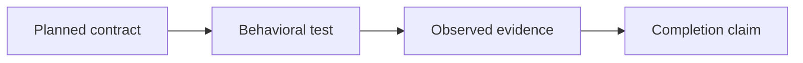

# wsr implementation status

Product status was checked on October 8, 2026; validation foundation evidence was added on
October 21, 2026; Rust dogfood guards and a native shell reference were added on
October 25, 2026. This file counts implemented
behavior, not design approval. See [PLAN.md](decisions.md) for decisions and [ROADMAP.md](roadmap.md)
for delivery gates.

## Present in the current checkout

- [x] November 6: real CLI static source inspection under D-031, with deterministic job/step
  summaries, file/YAML/shape diagnostics, unsupported-field and expression rejection, and malicious
  command/sentinel tests. See [CLI contract](../cli/README.md#static-workflow-inspection) and
  [worker checkpoint](../implementation/inspection-progress.md). This is the first bounded slice,
  not the complete inspection milestone or an execution compatibility claim.

- [x] Standard Cargo TDD guidance and manual-only shell/Python dogfood workflows.
  `cargo test -p wsr-gha --test workflow_examples --locked` validates example trigger
  contracts and the shell workflow's native pass/fail script. It does not test GHA-to-IR
  translation or WSR execution; those remain unchecked below.

- [x] Offline validation corpus foundation: catalog validation, pinned upstream snapshot integrity,
  native Python pass/failure references, and Cargo integration coverage. See
  [tests/README.md](../../tests/README.md). This does not validate WSR workflow execution or security.
- [x] Sixteen-product-crate Cargo workspace and binary entry point, with private template-based xtask tooling.
- [x] Typed CLI argument definitions, help/version, command dispatch, and consistent placeholder diagnostics/exit codes.
- [x] CLI parser/executable contract tests and smoke coverage of all eleven operational command paths.
- [x] Early serializable types, legacy provider trait, and errors.
- [x] CI/release workflow definitions (their existence is not runtime feature coverage).
- [x] Documentation distinguishes current scaffold, preserved prototype, accepted design, and proposals.

Design reconciliation on November 1, 2026 added D-024 and [GHA provider docs](../provider/gha/README.md).
Bun is now the intended GHA JavaScript compatibility runtime; this adds no implementation evidence.

## Not implemented in the current checkout

- [ ] Complete inspection milestone: dependency graphs, broader source diagnostics and canonical dogfood fixtures.
- [ ] Functional planning and executable canonical workflow compilation.
- [ ] Repository setup, configuration loading/generation, and provider bootstrap/pinning.
- [ ] Signed Component Model provider execution and canonical expression lowering.
- [ ] Workflow scheduling, expressions, matrices, outputs, and action resolution/execution.
- [ ] Bun-backed GHA JavaScript execution, action lifecycle, and qualified API compatibility.
- [ ] GHA environment/output/action-state channels and mixed component/system workspace tests.
- [ ] Component host, capability enforcement, and runtime/resource limits.
- [ ] Isolated Linux system execution on macOS and Linux hosts.
- [ ] Default permission policy and owner-authorized broad-access profile.
- [ ] Source snapshots, shared content store, artifacts, and structured execution evidence.
- [ ] Job/step state management, cancellation, timeout cleanup, and failure semantics.
- [ ] Engine reuse inside GitHub Actions.
- [ ] Global ready-job queue, max-jobs policy, dispatch and cross-repository coordination.
- [ ] Background lifecycle, authenticated local control and crash reconciliation.
- [ ] Verified runner/tool catalog provisioning and complete dependency closure.
- [ ] Cached action retention, offline acquisition rules and revocation enforcement.
- [ ] Repository-scoped telemetry and authorized shared resource correlation.
- [ ] Local evidence bundles, optional signing and connector delivery.
- [ ] Git hook management.
- [ ] Independent CI service, GitHub App deployment, remote workers, and Checks writes.
- [ ] Security/compatibility conformance suites or measured performance claims.

Ten operational command paths still report “not implemented yet” and exit with code 1.
`inspect` supports the [documented static subset](../cli/README.md#static-workflow-inspection); it does not prove execution support.
See the [CLI verification record](../archive/cli-skeleton.md#verification-record--2026-10-08).
Help and argument parsing do not
establish command functionality. Green scaffold CI is not proof of workflow execution or containment.

## Preserved prototype — not current completion

The local July 29 stash contains inspection/planning, snapshots/evidence, a development command
backend, and GitHub adapter work. The audit counted 29 test bodies but did not run them. These
features stay unchecked above until recovered, reconciled, tested, and present in the working implementation.
The original stash identity and recovery rules are recorded in [ARCHITECTURE.md](architecture.md).
