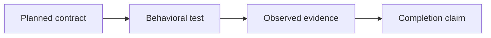

# wsr implementation status

Product status was checked on October 8, 2026; validation foundation evidence was added on
October 21, 2026; Rust dogfood guards and a native shell reference were added on
October 25, 2026. This file counts implemented
behavior, not design approval. See [PLAN.md](decisions.md) for decisions and [ROADMAP.md](roadmap.md)
for delivery gates.

## Present in the current checkout

- [x] Inspection host-boundary hardening: diagnostics escape control and Unicode format (bidi, zero-width) characters before reaching stderr,
  only regular files are read (symlinks followed; FIFOs, devices and directories exit 1), and a closed
  stdout pipe ends quietly instead of panicking. See [CLI contract](../cli/README.md#static-workflow-inspection).
  No input size limit is enforced (D-032); files over GitHub's 500 KB limit get a stderr warning.
- [x] Provisional typed inspection errors in `wsr-gha`: `inspect` failures carry an invalid versus
  valid-but-unsupported category and a source route, classified at detection against the pinned
  schema's keys; CLI diagnostics are unchanged. Not a stable, WIT or protocol contract.
- [x] Step `env`, `with` and `working-directory` in inspection: typed scalar values with
  literal/unevaluated text, sorted keys, step-kind restrictions; never bound, passed or resolved.
  See [step-input contract](../cli/README.md#step-environment-action-inputs-and-working-directories).
  Both canonical example workflows inspect successfully.
- [x] Job and step `if` in inspection: string conditions reported as written (bare or fenced),
  never parsed or evaluated; they do not affect reported jobs or steps. See
  [contract](../cli/README.md#unevaluated-job-and-step-conditions).
- [x] Workflow and job `env` and `defaults.run` in inspection: same value rules as step `env`;
  `shell`/`working-directory` defaults as literal/unevaluated text by schema context; never bound,
  merged or applied. See [contract](../cli/README.md#workflow-and-job-environment-and-run-defaults).
- [x] Dogfood inspection acceptance: golden `wsr inspect` output for the real `.github/workflows/example-*.yml`
  with directory, `PATH`-command and source sentinels showing no execution (`crates/wsr/tests/dogfood.rs`).
  Static inspection only, not execution support.
- [x] Roadmap Gate 1a (static inspection, D-031): dogfood acceptance (B-6) and the GitHub 500 KB
  warning (B-7, [contract](../cli/README.md#static-workflow-inspection)). Gate 1b (Component
  compilation and planning) remains unmet.
- [x] Job `timeout-minutes` and run-step `shell` in inspection: literal positive number or
  unevaluated timeout text, literal nonempty shell, reported as not applied/not selected. Unknown
  shells and malformed `uses` references are invalid (B-14; shape only, nothing resolved).
  See [timeout and shell contract](../cli/README.md#job-timeouts-and-step-shells).
- [x] Workflow and job `permissions` in inspection: `read-all`/`write-all` or a pinned-schema
  scope→level mapping, reported as requested and not granted. See [permissions contract](../cli/README.md#requested-permissions).
  No token, effective-permission computation or enforcement.
- [x] Workflow `run-name` in inspection: strict optional string, literal versus unevaluated
  classification of the whole decoded text and escaped rendering. See [run-name contract](../cli/README.md#unevaluated-run-names).
  No expression parsing/validation, context lookup or default application.
- [x] Diagnostic text matches the category (B-20): a recognized-but-uninspected schema key reads
  ``unsupported field `x`; this field is not inspected yet``; unknown keys keep serde text; step
  `background`, `wait`, `wait-all` and `cancel` are `Invalid` (pinned reader default); invalid `on`
  keys and dispatch fields name event or field. Verified by `diagnostics.rs`, `triggers.rs`,
  `environment.rs` and one CLI stderr test; dogfood goldens unchanged. See
  [record](../implementation/inspection-diagnostic-text.md).
- [x] Job `environment` in inspection: name, `url` and `deployment` as literal or unevaluated text,
  never selected; no protection rules evaluated (B-19). See [contract](../cli/README.md#job-environments).
- [x] Job `outputs` in inspection: sorted names with literal or unevaluated text, never resolved
  (B-18). See [contract](../cli/README.md#job-outputs).
- [x] Job and step `continue-on-error` and step `timeout-minutes` in inspection: literal or
  unevaluated, never applied (B-17). See [contract](../cli/README.md#continue-on-error-and-step-timeouts).
- [x] Workflow and job `concurrency` in inspection: group, `cancel-in-progress` and `queue` as
  literal or unevaluated text, never applied (B-16). See [contract](../cli/README.md#workflow-and-job-concurrency).
- [x] `on` events in inspection: scalar, sequence and empty-body mapping forms of every pinned-schema
  event, in source order, never evaluated or subscribed to; event configuration is unsupported (B-15).
  See [trigger contract](../cli/README.md#trigger-events).
- [x] `push`, `pull_request` and `pull_request_target` branch, tag and path filters in inspection:
  pattern lists in source order, never matched (B-22). See [contract](../cli/README.md#event-filters).
- [x] Reusable-workflow call jobs in inspection: `uses`, `with` and `secrets` as written; the
  referenced workflow is never opened, loaded or resolved (B-23). See [contract](../cli/README.md#reusable-workflow-calls).
- [x] Job and step `name` and job `runs-on` expressions in inspection: kept as unevaluated text, never
  evaluated or used to select a runner (B-24). See [contract](../cli/README.md#literal-runner-labels).
- [x] Job `container` in inspection: string image or mapping as written, never pulled, started or
  logged in to; passwords never printed (B-29). See [contract](../cli/README.md#job-containers).
- [x] Job strategies are inspected as source text, never expanded or applied (B-30; delivered on merge of its PR). See [slice record](../implementation/inspection-job-strategy.md).
- [x] Literal matrices inspect at any size; only alias amplification is rejected (B-32; delivered on merge of its PR). See [slice record](../implementation/inspection-matrix-size.md).
- [x] The workflow `description` is inspected as written (B-33; delivered on merge of its PR). See [slice record](../implementation/inspection-workflow-description.md).
- [x] Job `cancel-timeout-minutes` is inspected as source data, never applied (B-34; delivered on merge of its PR). See [slice record](../implementation/inspection-cancel-timeout.md).
- [x] `runs-on` group/labels selector mappings are inspected as written, never resolved to a runner (B-35; delivered on merge of its PR). See [slice record](../implementation/inspection-runner-selector.md).
- [x] Step `run` expressions in inspection: a script with `${{` text is flagged in its step heading,
  never printed, evaluated or executed (B-28). See [contract](../cli/README.md#static-workflow-inspection).
- [x] `on` required in inspection: a workflow without it is invalid, as in the pinned root schema (B-25).
- [x] Manual-trigger mappings and input declarations in inspection: typed metadata/defaults,
  deterministic reports, explicit unsupported/dynamic diagnostics and distinct declaration states.
  See [manual-input contract](../cli/README.md#manual-trigger-input-declarations). No input binding,
  default application or expression evaluation.
- [x] Literal scalar/list runner requirements in inspection: source form/order/spelling retained,
  quoted list output, strict shape/member validation and unevaluated-expression diagnostics.
  See [runner-label contract](../cli/README.md#literal-runner-labels). No runner resolution or execution.
- [x] Explicit step identities in static inspection: source preservation/rendering, strict identifier
  rules, per-job duplicate diagnostics, and no-ID/cross-job/case/boundary regressions. See
  [step ID contract](../cli/README.md#explicit-step-identities). This does not bind step outputs
  or evaluate expressions.

- [x] Static job-dependency inspection: scalar/list `needs`, deterministic edge summaries,
  unknown-reference/self-cycle/multi-job-cycle diagnostics, and valid DAG/repeated-edge/deep-chain
  tests. See [dependency contract](../cli/README.md#static-dependency-inspection). This does not
  implement scheduling or complete the inspection milestone.

- [x] November 6: real CLI static source inspection under D-031, with deterministic job/step
  summaries, file/YAML/shape diagnostics, unsupported-field and expression rejection, and malicious
  command/sentinel tests. See [CLI contract](../cli/README.md#static-workflow-inspection) and
  [worker checkpoint](../implementation/inspection-progress.md). This is the first bounded slice,
  not the complete inspection milestone or an execution compatibility claim.

- [x] Standard Cargo TDD guidance and manual-only shell/Python dogfood workflows.
  `cargo test -p wsr-gha --test workflow_examples --locked` validates example trigger
  contracts and the shell workflow's native pass/fail script. It does not test GHA-to-IR
  translation or WSR execution; those remain unchecked below.

- [x] Offline validation corpus foundation: catalog validation, pinned upstream snapshot integrity,
  native Python pass/failure references, and Cargo integration coverage. See
  [tests/README.md](../../tests/README.md). This does not validate WSR workflow execution or security.
- [x] Sixteen-product-crate Cargo workspace and binary entry point, with private template-based xtask tooling.
- [x] Typed CLI argument definitions, help/version, command dispatch, and consistent placeholder diagnostics/exit codes.
- [x] CLI parser/executable contract tests and smoke coverage of all eleven operational command paths.
- [x] Early serializable types, legacy provider trait, and errors.
- [x] CI/release workflow definitions (their existence is not runtime feature coverage).
- [x] Documentation distinguishes current scaffold, preserved prototype, accepted design, and proposals.

Design reconciliation on November 1, 2026 added D-024 and [GHA provider docs](../provider/gha/README.md).
Bun is now the intended GHA JavaScript compatibility runtime; this adds no implementation evidence.

## Not implemented in the current checkout

- [ ] Complete inspection milestone: richer source forms and diagnostics.
- [ ] Functional planning and executable canonical workflow compilation.
- [ ] Repository setup, configuration loading/generation, and provider bootstrap/pinning.
- [ ] Signed Component Model provider execution and canonical expression lowering.
- [ ] Workflow scheduling, expressions, matrices, outputs, and action resolution/execution.
- [ ] Bun-backed GHA JavaScript execution, action lifecycle, and qualified API compatibility.
- [ ] GHA environment/output/action-state channels and mixed component/system workspace tests.
- [ ] Component host, capability enforcement, and runtime/resource limits.
- [ ] Isolated Linux system execution on macOS and Linux hosts.
- [ ] Default permission policy and owner-authorized broad-access profile.
- [ ] Source snapshots, shared content store, artifacts, and structured execution evidence.
- [ ] Job/step state management, cancellation, timeout cleanup, and failure semantics.
- [ ] Engine reuse inside GitHub Actions.
- [ ] Global ready-job queue, memory-budget admission (D-032), dispatch and cross-repository coordination.
- [ ] Background lifecycle, authenticated local control and crash reconciliation.
- [ ] Verified runner/tool catalog provisioning and complete dependency closure.
- [ ] Cached action retention, offline acquisition rules and revocation enforcement.
- [ ] Repository-scoped telemetry and authorized shared resource correlation.
- [ ] Local evidence bundles, optional signing and connector delivery.
- [ ] Git hook management.
- [ ] Independent CI service, GitHub App deployment, remote workers, and Checks writes.
- [ ] Security/compatibility conformance suites or measured performance claims.

Ten operational command paths still report “not implemented yet” and exit with code 1.
`inspect` supports the [documented static subset](../cli/README.md#static-workflow-inspection); it does not prove execution support.
See the [CLI verification record](../archive/cli-skeleton.md#verification-record--2026-10-08).
Help and argument parsing do not
establish command functionality. Green scaffold CI is not proof of workflow execution or containment.

## Preserved prototype — not current completion

The local July 29 stash contains inspection/planning, snapshots/evidence, a development command
backend, and GitHub adapter work. The audit counted 29 test bodies but did not run them. These
features stay unchecked above until recovered, reconciled, tested, and present in the working implementation.
The original stash identity and recovery rules are recorded in [ARCHITECTURE.md](architecture.md).
