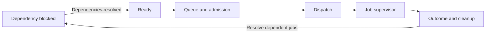
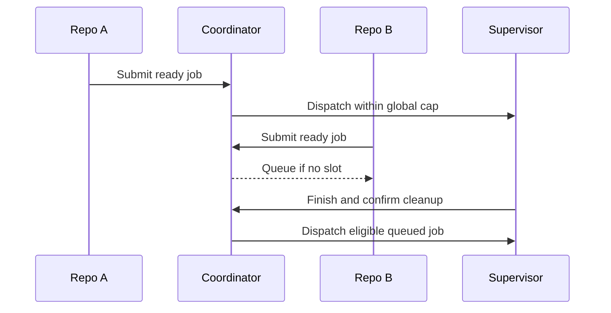

# Scheduling, dispatch and job execution

## Status and boundaries

D-012 assigns expression evaluation to the core, D-016 assigns job state/lifecycle to supervisors,
and D-028 defines global count admission. Execution remains unimplemented. The current engine
and expression crates contain documentation only.

The [planner](../planning/README.md) supplies translated semantics and requirements.
[Provisioning](../provisioning/README.md) supplies verified environment readiness.
[Policy](../policy/README.md) authorizes access and [backends](../sandbox/README.md) enforce it.
The engine coordinates those handoffs without embedding download URLs or GHA source syntax.

The arrow from blocked to ready applies only when conditions permit execution. Provider-defined
failure/skip/always conditions can skip or enable jobs; exact cases need fixtures. Cancellation
can apply in every phase. The diagram is a conceptual lifecycle, not a frozen state enum.

## Scheduler and dispatcher

| Responsibility | Inputs | Output |
| --- | --- | --- |
| Eligibility | Dependency outcomes, dynamic inputs, translated conditions | Ready, blocked, skipped or terminal job |
| Scheduling | Ready jobs across repositories, global policy and current capacity | Selected job or queue reason |
| Dispatch | Selected job, authorized requirements and qualified environment | Started supervisor or recorded startup failure |
| Supervision | Ordered steps, state channels, limits and cancellation | Step results, outputs, job result and cleanup events |

Global max-jobs defaults to 0, meaning no job-count cap. A positive cap applies across repositories.
Resource/platform/policy admission still applies. Queued ready jobs consume no active job slot.
Reserve a slot atomically when dispatch starts and retain it through cleanup; this is the proposed
slot-accounting mechanism and requires failure/crash fixtures before implementation.

Record dependency wait, preparation wait, concurrency-cap wait and resource wait separately.
Queue policy/fairness, budgets, preparation concurrency and slot reservation timing remain open.
FIFO with cross-repository fairness is a candidate, not an approved algorithm. No time-slicing or
preemptive job suspension is selected.

## Job state and chained outputs

Each job has a private workspace and explicit tool/service/output lifetimes. Each step receives
its own grants and private scratch. Shared job state crosses through controlled channels.

A step output becomes available according to provider-lowered publication rules. Job output
expressions consume step results; dependent jobs consume published job outputs through the core.
A string containing an artifact path does not transfer its bytes. File/artifact transfer requires
explicit mechanisms and authorization. GHA channel semantics are owned by
[the provider state guide](../provider/gha/state.md).

Define failed-step writes, output validation/timing, cancellation, timeout, cleanup ordering,
concurrent state access and crash atomicity before implementation. Never replay a partially executed
step under broader permissions. Selecting one system step does not widen all steps in the job.

## Foreground and background ownership

A shared engine library with foreground execution and an optional per-user service is the current
proposal. The service could coordinate multiple repositories and retain runs across CLI disconnect.
Daemon startup/installation, IPC authentication, persisted queues, fair sharing and recovery remain
open. Separate CLI processes must not each claim to enforce a device-wide cap without coordination.

Persisted state is not proof that a process survived or died. Recovery must reconcile process/run
identity, environments and reserved resources before admitting replacements. Repository logs,
credentials and mutable workspaces stay isolated. Shared cache access uses leases and atomic writes.

## Validation and evidence

Test dependencies/conditions, two-repository count enforcement, capacity changes during dispatch,
cancellation in queue/start/run/cleanup, startup failure releasing reservations, daemon reconnect
and crash reconciliation. Emit scoped lifecycle/wait events for [observability](../observability/README.md)
and immutable identities/results for [evidence](../evidence/README.md).
No production API, job-state schema or backend interface is frozen by this guide.
