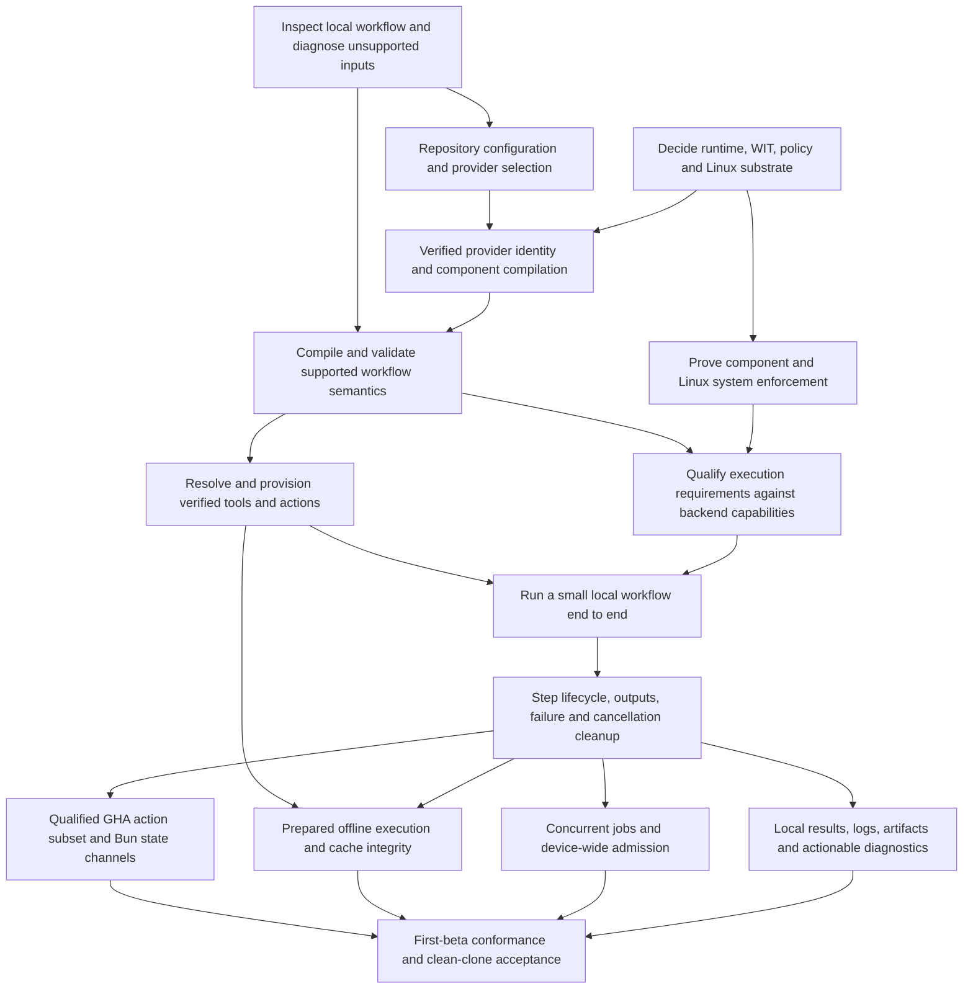

# Proposed first-beta feature dependencies

This is a delivery map derived from the [roadmap](../context/roadmap.md), not a new
architecture decision or permission to implement every node. Only workflow inspection is
currently authorized for the autonomous worker. The owner requested this map on November 6,
2026 so future schedules can select prerequisites rather than accumulate unrelated work.
Beta membership below is proposed; accepted decisions remain in
[decisions](../context/decisions.md). No beta release date or compatibility guarantee is implied.

## Dependency graph

Arrows mean a prerequisite is needed before the dependent feature can be called delivered.
They do not require all implementation work to occur serially. Inspection is the first product
slice; backend qualification has independent design and adversarial-test prerequisites.

## Delivery gates

| Feature group | Evidence needed before delivery | Open gates |
| --- | --- | --- |
| Inspection | Real CLI fixtures show jobs, ordered steps, references and needs; invalid/dynamic inputs have explicit diagnostics; sentinel tests prove no workload execution or repository mutation | Provider entrypoint and relationship to the signed Component boundary |
| Configuration and compilation | Explicit/unambiguous provider selection, reproducible compilation, minimal provider-neutral representation, source diagnostics and invalid-plan rejection | WIT, pin schema, canonical extension/serialization contracts |
| Provisioning | Exact verified identities and dependency closure, correct setup timing, private activation, corruption rejection | Catalog/profile schema and approved acquisition policy |
| Execution boundaries | Permitted behavior works; adversarial filesystem/network/process probes fail; missing enforcement blocks startup | Runtime/WASI baseline, Linux substrate, permission semantics |
| Local workflow execution | The same fixture runs through WSR; dependencies, failure, skip, outputs, timeout and cancellation have observed assertions | Initial execution subset and supervisor/backend handoff |
| GHA actions | Named action/API subset passes real WSR lifecycle and state-channel tests inside the enforced backend | Bun version, provisioning and supported subset |
| Prepared execution | Networking-disabled run works with verified prepared inputs; misses, revocation and corruption fail precisely | Retention and acquisition contracts |
| Concurrency | Multiple jobs/repositories obey admission limits, ownership and crash/cancellation cleanup | Coordinator lifecycle, authentication and recovery |
| Local results and diagnostics | Users can locate logs/results/artifacts and diagnose failure without leaking secrets or cross-repository data | Evidence and telemetry schemas |
| Beta acceptance | All selected gates pass from a clean clone on explicitly qualified platforms; documented unsupported inputs fail honestly | Owner approval of final beta membership |

Optional remote reporting/signing, hosted CI service, extra providers, native macOS/Windows
jobs, hooks and a daemon as the primary experience are outside this proposed beta gate.
No existing crate is a required feature merely because its name exists.

## Rules for future workers

Select the earliest authorized unmet prerequisite. Finish its acceptance behavior and integration
before starting its dependent feature. Use the same named fixtures through inspection, compilation
and eventual execution, while keeping evidence for those stages distinct. New runtime paths need
new acceptance evidence; an inspection pass never proves execution compatibility.

Keep one feature PR active, preserve the baseline regression assertions, and repair regressions
introduced by the feature within that PR. Change existing code only when the feature requires it.
An unrelated failure or unresolved architecture decision is a blocker, not a reason to rename,
refactor, change hooks, or enlarge the milestone. Update this map when an owner decision changes
dependencies; put the decision itself in its canonical owner.
