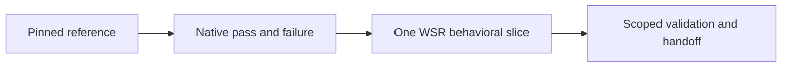

# Java E2E implementation worker

> Status: **paused**. The owner stop recorded in the
> [current checkpoint](java-progress.md#current-checkpoint--november-5-2026) supersedes the historical
> authorization below. This document preserves the worker contract; it does not authorize resumption.
> Before product work, obtain explicit resumption and reconcile the bounded behavior, architecture
> and external worker prompt. Documentation cleanup does not change or restart any schedule.

## Architecture alignment after the documentation refactor

Follow [planning](../planning/README.md), [provisioning](../provisioning/README.md),
[cache](../cache/README.md), [engine](../engine/README.md) and [evidence](../evidence/README.md).
Native reference setup may use independently qualified disposable environments; this does not select
Docker or a VM product backend. Preserve the tutorial's actual versions/commands when claiming
tutorial equivalence; any different native fixture/toolchain must be labelled as an adaptation.
User stop/hold instructions in the owner session take precedence over automated implementation.
The saved automation prompt is external to this document and has not been edited by the refactor.

## Historical authorization and scope

On November 1, 2026 the owner authorized replacing the scheduled test-preparation task with a
Java E2E TDD worker. This is a bounded exception to the previous design-only implementation gate.
The worker may prepare fixtures, add meaningful tests, implement product behavior with settled
contracts, run validation, and maintain evidence. It must not silently select unresolved runtime,
policy, isolation, canonical-IR, or plugin interfaces. Routine implementation details within an
accepted contract can be resolved without repeated permission requests.

Work directly in `/Users/carlosferreyra/Development/ectorial/wsr`, in local mode. Preserve the
existing DX/design changes and prototype stash. Do not reset, clean, overwrite, blindly switch to
main, or apply the stash. Resume task-owned work and preserve unrelated changes. No Git worktrees,
new repositories, publication, releases, deployments, automatic merges, or product-code pushes/PRs
are authorized by this worker. Keep product changes local and reviewable. Existing authorization
for test/documentation PRs is unchanged, but do not disguise product changes as test-only work.

## Target and reference hierarchy

Use [Java DX](../dx/java.md) and [its YAML](../dx/java.yml) as the intended experience, not execution
proof. Follow [PLAN.md](../context/decisions.md), the [GHA contract](../provider/gha/README.md), and the
[TDD contract](../testing/strategy.md#11-tdd-and-agent-implementation-contract). Upstream action/tool
semantics and observed native behavior establish reference outcomes; synthetic tutorial logs do not.
Do not implement an output imitation or special-case fixture names in product code.

Start with one small Maven/Java project using GitHub Actions. Select and record an appropriately
licensed, pinned source commit and workflow with checkout, Java setup and wrapper-based verification.
Prefer public dependencies and a small deterministic test suite; exclude publication/deployment jobs.
Inspect source, build scripts, actions and prerequisites before execution. Use a minimal owned
reproduction when reducing a bug, while retaining the original case's identity and provenance.
Do not choose a new project every run. No Gradle/other-language expansion until this milestone passes.

Pin action revisions and record JDK, wrapper, provider, runtime, image, architecture and dependency
inputs. Explain any workflow adaptation; a modified example is not unchanged upstream compatibility.
Keep canonical example projects/workflows in existing repository conventions. Link DX copies or
verify exact agreement rather than maintaining divergent versions.

## Execution and environment

Fetching/inspecting the selected public source and dependencies is permitted for explicit worker
preparation. Ordinary Cargo tests must not fetch or execute upstream workloads implicitly. Use
ignored `target/wsr-tests/java/` for disposable sources and raw logs, never personal directories.
Use an independently isolated Linux reference environment with narrow mounts, no ambient personal
credentials, resource limits and cleanup. WSR's unimplemented sandbox is not that reference boundary.
If no approved environment exists, prepare/review inputs and report the specific prerequisite; do
not run unreviewed upstream build scripts directly on the Mac. Use the repository's existing managed
tooling configuration. Do not dispatch hosted workflows or provision paid services automatically.
A local Maven command is a native tool reference, not a complete native GHA workflow execution.

## Per-run TDD loop

1. Read [progress](java-progress.md), live branch/diff, coverage index and any pending task. Acquire
   exclusive checkout ownership using an atomic run lock under `target/wsr-tests/`; record owner,
   process/run identity and start time. If another live writer owns it, do not mutate. Recover a stale
   lock only after verifying its owner is no longer active. Release ownership on completion/failure.
2. Resume an unfinished bounded behavior before selecting another. Describe behavior, accepted
   interface, fixture, exact command, intended failure, non-goals and completion criteria before code.
3. Establish/refresh native reference success and controlled failure when relevant inputs change.
   Missing tools, downloads or compilation failures are setup failures, not product red evidence.
4. Observe a meaningful failing test through the actual owning API/CLI. Implement the minimum
   general behavior, observe green, then refactor within scope. Do not ignore tests, weaken assertions,
   accept generic placeholder output as sufficient red, or write a speculative disabled suite.
5. Run focused tests, relevant regressions and `git diff --check`. Before claiming a completed slice,
   run `cargo xtask ci`; report environmental failures and unexecuted lanes honestly.
6. Update progress and link behavior/tests/results in `docs/testing/coverage.md`; update implementation
   claims only when proven. Preserve the exact next command and branch for interrupted work.

One bounded behavior per invocation is the default, not a requirement to manufacture a commit.
GPT-6 Astra (`gpt-6-astra`) orchestrates the worker. For actionable work, spawn bounded subagents
with explicit `gpt-6.1-sol` or `gpt-6.1-terra` models and `fork_turns=none`; supply self-contained
contracts, files, commands and acceptance criteria. Sol handles implementation/tests; Sol or Terra
can review or handle scoped fixture/documentation work. Astra selects the slice, coordinates TDD,
reviews evidence and integrates. Keep one writer per file/slice and parallelize only independent
work. Preserve default reasoning effort. Record actual agent/model assignments; report unavailable
requested models rather than silently substituting. No second agent may write conflicting files. Preserve deliberate red
work locally on the identified development branch, never by breaking main or pretending it passed.

## Milestones and acceptance

- Prepare the pinned project and independent native pass/fail reference evidence.
- Translate/inspect its supported workflow semantics without workload execution.
- Deliver required general execution/state behavior under the accepted security contracts.
- Qualify the selected checkout/setup-java actions under Bun; distinguish that from JVM execution.
- Execute the Maven workflow through WSR, verify test outcomes and inspect expected JAR contents.
- Prove controlled test failure, downstream status, state transfer and descendant cleanup.
- Prove cold/warm cache behavior and relevant input invalidation without cached test success.
- Qualify the macOS-to-Linux path separately from Linux-only results.

For each stage, settle only the prerequisite contract needed next. If a design decision blocks it,
record two concrete options and a recommendation, request the smallest decision, and continue only
independent authorized work. Do not repeat unchanged blockers or invent architecture to get green.

Completion means the selected workflow's real WSR execution, controlled failure, state, cache and
cleanup criteria are backed by runnable tests and recorded identities/results. Report completion
and perform no further implementation until another milestone is authorized. A task report does not
pause/delete its schedule; scheduling changes remain explicit. No live publishing is in this goal.
