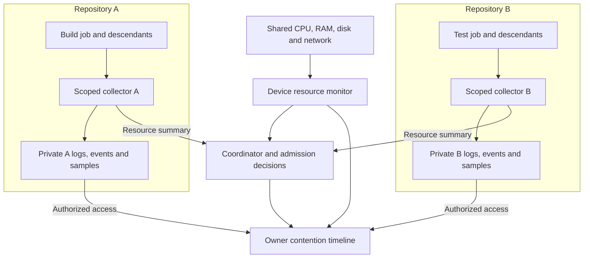
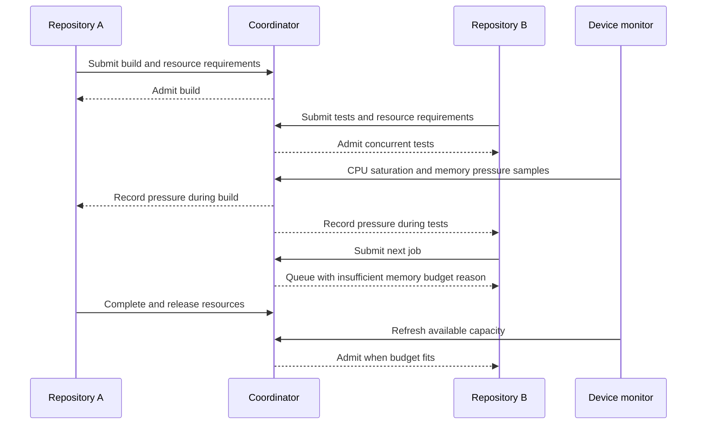

# Observability and resource contention

## Status and scope

Planned design under D-026. Collectors, storage, dashboards and daemon coordination remain
unimplemented. The wsr-tracing crate is a logging/reporting placeholder.

Help developers distinguish execution time, scheduling waits, provisioning delays and contention
when several repositories run CI on one device. Repository records retain separate access scopes.

## Collection and visibility

Execution records carry repository identity, workflow revision, run, job and step IDs where
applicable. Use timestamps for correlation and monotonic durations for elapsed time. Repository
identity across clones/renames and the event schema remain open.

Repository views include only authorized logs, outputs, events and attributed measurements.
Device-wide measurements and cross-repository overlays require owner-authorized visibility.
A restricted view may report unavailable capacity without exposing another repository's name,
paths or activity. Co-location and shared cache use grant no access to other repository records.

## Resource groups

| Resource | Attributed job data | Device data | Interpretation |
| --- | --- | --- | --- |
| CPU | CPU seconds, average cores, quota, throttled time where measurable | Busy cores, capacity, pressure | Define percentage units, for example 100% equals one core |
| RAM | Current/peak scoped memory, limit, OOM events | Available RAM, pressure, swap | Distinguish RSS, charged memory and VM allocation |
| Disk | Read/write bytes and rates, workspace size | Free space, device latency and pressure | Bytes alone cannot establish an I/O bottleneck |
| Network | Attributed bytes/rate where supported, fetch duration | Interface throughput, connectivity | Shared connections can prevent attribution |
| Processes | Descendant count, limit, cleanup events | Overall resource pressure | Disclose incomplete child-process coverage |
| Scheduling | Queue duration, recorded wait reason, resource budget | Active reservations, concurrency limits | Separate waiting from execution |
| Provisioning | Cache hits/misses, verification/fetch/lock waits | Shared acquisition and cache pressure | Link multiple waiters to one shared download |

Each sample records scope, units, time interval and collector/backend identity. Missing metrics
are unavailable rather than zero. Bound capture overhead and make gaps/dropped samples visible.
An aggregate VM measurement must retain VM scope when job attribution is unavailable.
Avoid double counting a VM and its contained jobs. Peaks cannot be summed as simultaneous usage.
Device totals include the OS, shared runtime, coordinator and unrelated applications.

## Two-repository example

Synthetic illustration on an 8-core, 16 GiB device. These values are not observed measurements.

| Time | Repository A | Repository B | Shared observation |
| --- | --- | --- | --- |
| 0–10 s | Build uses 4 cores, 5 GiB | Idle | 5 busy cores, 7 GiB used |
| 10–25 s | Build uses 4 cores, 5 GiB | Tests use 3 cores, 6 GiB | 8 busy cores, 13 GiB used |
| 25–30 s | Build uses 3 cores, 5 GiB | Tests use 3 cores, 8 GiB | 7 busy cores, 15 GiB used, memory pressure |
| 30–40 s | Build complete | Next job waits for memory budget | Capacity/reservations refreshed before admission |
| 40–50 s | Idle | Next job running | Pressure reduced, job budget fits |

Measured usage and reserved budgets differ. Unrelated processes can also affect available capacity.

Align execution, resource samples, provisioning and queue intervals in a run timeline. An
authorized owner can overlay repositories. Distinguish recorded admission reasons from inference.
For example, a memory-budget queue wait is a scheduler fact; CPU saturation overlapping a slow
build is correlation. Claiming that repository B caused a particular slowdown requires comparable
controlled runs with matching source, tools, environment and cache conditions. Avoid assigning
causality or slowdown percentages from overlap alone.

## Privacy, persistence and validation

Treat workload logs as untrusted. Exclude secret values from structured records and redact captured
output before persistence/export. Redaction has limits for arbitrary workload-generated secrets.
Define bounded per-repository and device quotas, retention and deletion under owner policy.
Keep logs outside the immutable package cache. Remote export requires explicit configuration.

Before implementation, specify crash-safe writes, incomplete-run markers, stream ordering and
reconnection, sampling intervals, storage formats and collector capabilities. Background runs
must retain accounting after CLI disconnect. Exact commands/UI and export protocols remain open.

Acceptance gates cover two-repository access separation; descendant attribution; device totals
with unrelated load; honest unavailable metrics; units/gaps; admission-linked wait reasons;
bounded collection and retention; redaction; cancellation cleanup; reconnect/crash recovery;
and permission-checked cross-repository views. These are future test requirements.
