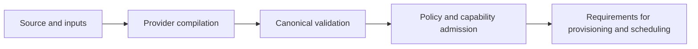

# Planning and validation

## Status and ownership

Accepted responsibilities from D-003–D-012, D-019 and D-025. Canonical schemas, APIs and phase
interfaces are open. The current engine and expression evaluator remain scaffolds.

The provider compiles source-specific semantics. Planning consumes its canonical result and
explicit invocation inputs. It preserves provenance, binds available values, validates references
and dependencies, and produces requirements for authorization, provisioning and scheduling.

## Distinct validation responsibilities

| Stage | Owner | Output or failure |
| --- | --- | --- |
| Syntax and provider compatibility | Provider compiler | Canonical model, provenance, unsupported-source diagnostics |
| Canonical structure | Planner | Valid references, dependencies, admitted expressions/extensions |
| Platform and authority | Planner with trusted policy | Supported backend requirements and permitted capabilities |
| Package identity and closure | Provisioner/cache | Verified immutable inputs or acquisition diagnostic |
| Current capacity/readiness | Scheduler/dispatcher | Admit, queue with a reason, or reject |
| Runtime grants/state | Supervisor/backend | Enforced operations and validated state publication |
| Results/claims | Evidence and verifier | Recorded outcomes/artifact identities, verified claims under explicit trust |
| Product correctness | Development test suites | Behavioral evidence in TEST-COVERAGE, not runtime authorization |

Compilation alone cannot discover every tool in arbitrary scripts. D-025 requires a supported
declaration/resolution contract for dynamic external requirements. Tools built during a job have
their own execution policy. Reject unsupported known requirements before workload side effects.

## Dynamic values and handoff

Event values, job/step conditions, matrix entries and outputs become available at different phases.
Evaluate translated expressions only when their dependencies are available. Preserve provider-defined
failure/skip semantics. Exact support for output-derived matrices and resource requirements needs
fixtures before implementation. D-025 initially rejects unknown output-dependent tool/target
requirements before workload execution unless all needed alternatives were admitted in advance.
Staged discovery of new external requirements is a future proposal.

The conceptual handoff contains source identities, canonical model/diagnostics, input bindings,
platform/capability/tool requirements and dependency/output relationships. It is not a frozen Rust
type or serialization format. Resource or policy changes can require dispatch-time revalidation.

A blocked dependency is different from a ready job awaiting device capacity. The scheduler owns
that distinction; this guide owns the semantics that determine eligibility.

## Failure and verification

Syntax, invalid graphs and unsupported requirements yield source-linked diagnostics. Planning
executes no workload code. Cancellation during acquisition/planning must not leave an eligible
partial plan. Reuse derived plans only when all relevant source, provider, compiler, configuration,
input and policy identities match.

Test cycles/references, invalid expressions, unsupported features, no workload side effects,
dynamic output timing and accurate rejection locations. See [testing](../testing/strategy.md) and
[engine](../engine/README.md).
