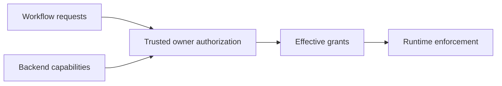

# Trusted policy and admission

## Authority and status

D-018–D-022 define deny-by-default authority. Exact policy/grant formats, credential provisioning
and broad-access scope remain open. This guide assigns responsibilities without selecting a backend.

Repository configuration and custom manifests request access. Machine owner or administrator
policy authorizes it. Backend capabilities determine whether denials can be enforced. Unsupported
enforcement blocks admission. CLI convenience flags cannot authorize themselves.

## Policy domains

| Domain | Examples |
| --- | --- |
| Acquisition trust | Approved catalogs/sources, provider/action/package identity and verification |
| Execution | Filesystem views, networking, environment/secrets, process launches and resources |
| Shared cache | Eligible trust namespaces, quotas, retention, explicit removal |
| Scheduling | Device-wide count cap and allowed concurrency/resource settings |
| Observability | Repository access, device summaries, correlation, retention and exports |
| Reporting/signing | Approved destinations, credentials, signer use and allowed claims |

A verified binary's presence grants no right to run it or access cached neighbors. Step-specific
grants do not authorize subsequent steps. A broad-access exception requires explicit trusted
selection, and cannot bypass absent semantics or invent GitHub credentials.

## Lifecycle

Planning checks known requirements. Acquisition has its own authority. Dispatch rechecks relevant
policy and capacity against the environment actually used. Runtime boundaries enforce access and
the supervisor validates exported state. Define policy-change handling for active runs before
implementation; never imply retroactive revocation from a cached authorization result.

No automatic more-permissive retry follows partial execution. Cancellation must stop descendants
and revoke private resources. [Security model](../security/README.md) owns threat assumptions and
residual risks. Test both permitted and denied operations, custom-source restrictions, secrets,
cross-repository isolation and missing-enforcement rejection.
