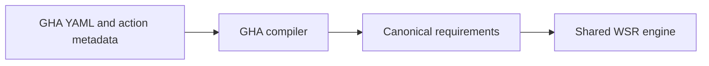

# GitHub Actions provider

**Current scaffold:** the `wsr-gha` library contains documentation only. Its tests validate example
inputs and native shell references; they do not translate or execute workflows through WSR.

**Accepted design:** retain the provider adapter and lower GitHub Actions semantics into the
provider-neutral execution model. Use Bun for compatible GHA JavaScript actions inside the isolated
system backend. No GHA parser, Bun integration, component executor, or state bridge is implemented.

## Documentation ownership

[PLAN.md](../../context/decisions.md), especially D-024, owns accepted decisions. This guide owns their GHA-specific
interpretation and validation requirements. Shared scheduling, authorization, execution, and state
mechanisms remain core responsibilities. These pre-alpha documents describe the design at this
revision; they do not freeze APIs, schemas, crate boundaries, or compatibility across commits.

| Document | Responsibility |
| --- | --- |
| [Architecture](architecture.md) | Provider boundary, execution paths, and remaining design gaps |
| [Compatibility](compatibility.md) | Action categories, Bun qualification, and unsupported behavior |
| [State](state.md) | GHA state channels mapped to shared supervisor contracts |
| [Validation](validation.md) | Evidence required before advertising support |

The generic [provider contract](../README.md) remains authoritative for all providers.
The [implementation checklist](../../context/status.md) records delivered behavior. Design approval does
not complete any execution or security gate.
