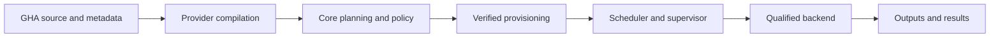

# GHA execution architecture

**Accepted design, not implemented.** [D-024](../../context/decisions.md#d-024--gha-compatibility-through-bun)
selects Bun for compatible JavaScript actions and keeps the provider-neutral core. Concrete contracts
listed as open below require decisions and tests before implementation; no stable Rust API is proposed.

## Flow and ownership

The provider adapter persists. Its compilation plugin does not execute actions or call Bun while
inspecting a workflow. Action source/metadata acquisition must not run repository-controlled code.
The provider describes requirements; the planner selects an enforceable environment before workload
side effects. Dynamic expressions are lowered for core evaluation at their defined phases.

| Owner | Responsibility |
| --- | --- |
| GHA provider | Source syntax/defaults, expressions, action metadata, lifecycle lowering, compatibility diagnostics, and source locations |
| Core planner/policy | Dependency validation, backend availability, capability authorization, and rejection of unsupported requirements |
| Provisioner | Acquire and verify declared actions/runtimes/tools while preserving setup effects and activation timing |
| Scheduler/dispatcher | Global readiness and capacity admission; no GHA YAML interpretation |
| Job supervisor | Step lifecycle, shared state, outputs, cancellation, timeouts, and cleanup |
| Execution backends | Invoke approved artifacts/runtimes with enforced filesystem, network, process, secret, and resource restrictions |

GHA-specific action and workflow-command semantics stay owned here. The runtime packaging of any
GHA compatibility helper is open: it must lower to explicit core operations or an admitted, versioned
extension. It must not introduce opaque provider callbacks into execution or embed GHA syntax in the
core scheduler. Unrepresentable semantics produce diagnostics instead of being silently discarded.

## Execution paths

| Path | Eligibility and prerequisites | Boundary and outcome |
| --- | --- | --- |
| Component | A compatible, identified component artifact and supported host imports; GHA-to-component mapping is still open | Component host enforces typed grants; exports declared state/results |
| Bun JavaScript | Action metadata and dependencies qualified against a selected Bun version and platform | Bun and descendants run inside the system boundary; action lifecycle and state channels preserve the supported GHA subset |
| Shell/tool | Supported shell, toolchain, platform, and declared capabilities | Isolated system execution; no conversion to Wasm is implied |
| Container | Actual container semantics required and an approved backend available | Explicit container requirement; MVP inclusion and implementation remain open |

These are capability-based paths, not a mandatory three-stage ladder. QuickJS is not a required
intermediate runtime. Bun is a runtime inside system isolation, not an independent security boundary.
Unknown compatibility must not silently become permission to execute. A Bun-incompatible action is
rejected unless another qualified path has been explicitly selected before execution; no Node fallback
is currently selected. No partial step is automatically replayed with another runtime or wider grants.

## Remaining gaps

All paths above are unimplemented. Before delivery, settle canonical execution requirements and
extension admission, Bun version/provisioning/integrity, action resolution and lifecycle lowering,
command-protocol placement, system isolation, workspace semantics, and platform coverage. Bun executable
bundling is a separate open optimization, not a prerequisite or an accepted substitute for runtime
qualification. See [compatibility](compatibility.md), [state](state.md), and [validation](validation.md).
