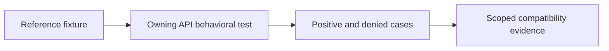

# GHA validation gates

**Planned tests, not completed coverage.** Existing `workflow_examples.rs` checks input contracts and
native shell behavior only. The CLI placeholder tests establish no GHA translation, Bun execution,
workspace consistency, or isolation. See the [current checklist](../../context/status.md).

## Required evidence

| Gate | Positive evidence | Negative evidence |
| --- | --- | --- |
| Compilation | Representative workflows/actions produce expected canonical plans and provenance | Invalid/unsupported source is diagnosed; inspection cannot execute repository-controlled commands |
| Bun action | Pinned action runs with identified Bun/platform, inputs, outputs and declared API coverage | Unsupported runtime/API/native dependency is diagnosed without permissive replay |
| Lifecycle | Supported pre/main/post conditions, state scope, ordering and cleanup match reference fixtures | Failure, skip, timeout and cancellation do not leak state or leave unauthorized descendants |
| State channels | Environment, PATH, output and action-state updates have the specified visibility | Malformed/oversized commands, cross-action state access and path substitution fail as specified |
| Mixed backends | Component creates a file; Bun reads/modifies it; a later component observes the change and a declared output | Denied paths and private scratch/secrets remain inaccessible in both directions |
| System isolation | Explicitly granted files/network/tools work | Missing enforcement blocks startup; denied host access, child-process escape and resource excess are contained |
| Failure semantics | Approved failed-step write and cleanup rules are observed | No implicit rollback assertion or automatic replay on a stronger backend |

Tests should identify action revision/digest, runtime version, platform/image, policy/grants, source
inputs, expected outcomes, and actual results without recording secrets. Use official upstream
semantics and controlled native references where appropriate. Reference success alone is not WSR support.

## Delivery sequence

1. Specify one inspect-only translation contract and observe its failing behavior test.
2. Prove one component execution path and one isolated system path with denied-access tests.
3. Qualify a minimal Bun action, including environment/output handling and action lifecycle scope.
4. Connect both backends through the supervisor and prove mixed workspace visibility and isolation.
5. Expand action categories and APIs only through explicit fixtures and diagnostic coverage.

Use ordinary owning-crate Rust tests and the existing [testing contract](../../testing/strategy.md).
This document does not invent callable APIs, approve implementation of unresolved contracts, or mark
planned cases as passing. Update the compatibility matrix and checklist when implementation evidence exists.
