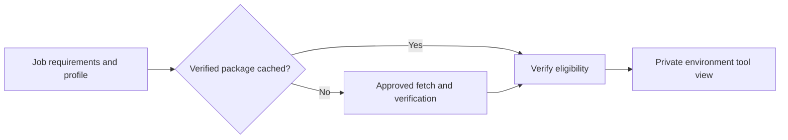

# Runner environments and tool provisioning

## Purpose and status

D-025 and D-027 define tool preflight and acquisition. D-029 records catalog direction and schema
proposals. Provisioning is unimplemented. Concrete packaging and environment mechanisms remain open.

Supply the required verified environment on demand while preserving the workflow's requested
platform and setup semantics. A ready environment includes dependency libraries and activation
information, not merely executable download URLs.

## Three distinct descriptions

| Description | Includes | Owner |
| --- | --- | --- |
| Runner profile | Revision/provenance, OS/ABI/architecture, tool defaults, libraries, shells, paths, environment, user/service facilities | Maintained environment specification |
| Tool package | Exact version/target, approved source URLs, digest/signature policy, dependency closure, extraction and activation | Package catalog |
| Resolved run environment | Exact profile/package identities, supplied paths, effective grants and collector/backend identity | Invocation evidence |

CPU/memory capacity can be measured or configured on the actual device. Do not treat a profile's
hardware description as a guarantee of available local resources. Requested runner targets must
be matched explicitly. ARM64 host tools cannot silently satisfy a Linux x64 target.

Custom runner profiles can describe company tools, sources and dependencies under trusted policy.
Profile inheritance, formats, catalog distribution/signing and conflict rules remain proposals.
GitHub's [image index](https://github.com/actions/runner-images#available-images) and
[Ubuntu software inventory](https://github.com/actions/runner-images/blob/main/images/ubuntu/Ubuntu2404-Readme.md)
inform compatibility research. Record the actual upstream image release behind moving labels.

## Acquisition and activation

Resolve supported known requirements before running workflow steps. Use exact pinned identities.
Reuse eligible cache objects without contacting upstream. On a miss, acquire from permitted sources,
verify staged bytes, safely unpack and publish atomically through the [cache](../cache/README.md).
Never execute installer scripts as part of provider compilation. Installer execution, if supported,
requires its own authorized execution contract.

A changed YAML file triggers normal resolution. Cache misses and downloads appear as progress.
Unsupported tools, failed/auth-denied downloads, unavailable revisions, corrupt packages, denied
sources or missing offline objects produce actionable diagnostics. Upstream deletion is irrelevant
to a verified cached pin unless trusted revocation policy prohibits its use.

Provide controlled executable/library paths per job/step. Pre-acquiring Temurin 21 does not activate
it before a setup-java step requests it. Preserve JAVA_HOME/PATH timing, setup effects and versions.
A configured profile must define which tools are initially available, separately from packages
prepared for later steps. Common utilities may be a pinned uutils subset after compatibility tests;
shells, curl, Git and JVMs need separate qualification.

## Discovery limits and coordination

Initial preflight covers the selected invocation. Output-dependent external tool/target requirements
block it unless all required alternatives can be admitted beforehand. Later selection of an admitted
alternative still needs defined semantics. Staged discovery after earlier jobs run is a future proposal.

Arbitrary scripts may compute commands or create tools. Define supported declarations/resolution
and produced-tool execution policy before admitting such cases. No generic replay of a failed
command after installing guessed dependencies is permitted. Unknown actions cannot be admitted
merely because their sources are downloadable.

The scheduler consumes environment readiness and resource requirements. Provisioning reports
progress/failure and supports cancellation. How preparation capacity is limited, when job slots
are reserved and how environments are leased remain open. Do not hold a running-job slot for
long downloads without an explicit reservation rule. Clean staging/private views on failure and
release leases after job cleanup.

## Acceptance gates

Test verified cache reuse with networking disabled, approved misses, full library closure, corrupt
downloads, archive traversal, target/version mismatch, cancellation, custom-source policy and
setup timing. Reference Maven success and WSR workflow execution are separate evidence lanes.
Provisioning does not promise deterministic external services or truthful workload results.
