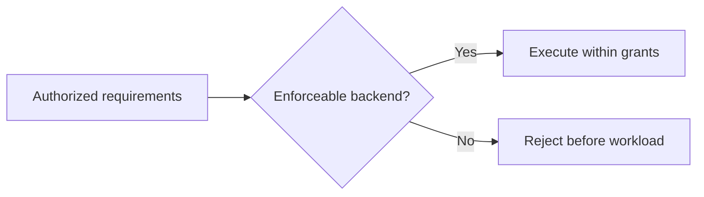

# Execution backends

## Current scaffold

[wsr-sandbox](../../crates/wsr-sandbox/src/lib.rs),
[wsr-wasix](../../crates/wsr-wasix/src/lib.rs), and
[wsr-shell](../../crates/wsr-shell/src/lib.rs) contain documentation only.
There is no implemented component runtime or isolated shell executor. The legacy tier names do
not choose Wasmtime, Wasmer, WASIX, a WASI version, or a measured startup time.

## Accepted design — planned

The Component Model is a core security boundary with typed, explicitly authorized host interfaces.
Ordinary tools use an isolated Linux system backend. Both paths must enforce their stated contracts;
execution is rejected when required restrictions cannot be enforced. Assume malicious workloads.

D-024 selects Bun for compatible GHA JavaScript actions inside the system backend. Bun and child
processes require the same enforced grants and lifecycle limits as other system tools. QuickJS is
not required, and a failing action is not retried under Node or broader permissions. Bun versions,
provisioning, and optional executable bundling remain open; see the [GHA design](../../crates/wsr-gha/README.md).

Linux jobs run from macOS and Linux machines first. VM-backed Linux execution is needed on macOS;
the Linux outer boundary and concrete runtime are open. An explicit broad-access compatibility
profile is accepted, with scope/syntax still unsettled. It never activates automatically.

The supervisor maintains explicit shared job state; step-specific isolation does not erase declared
state or confer trust on shared files. Consult [the security model](../SECURITY-MODEL.md) and
[PLAN.md](../../PLAN.md) before implementing a backend or advertising a guarantee.
