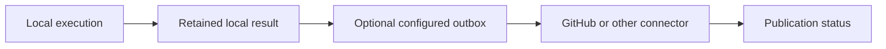

# Optional integrations and reporting

## Core independence and status

D-017 and D-027 require independent local execution with prepared inputs. GitHub registration,
scheduling and API availability do not gate that execution. Integration handlers and the daemon
remain stubs. Hosted worker fleets, GitHub App deployment and remote CI administration remain later scope.

## Reporting and attestations

Only configured destinations receive results. [Evidence](../evidence/README.md) owns immutable
result identities and signing claims. Connectors own authentication, remote API mapping, publication
status and retry/idempotency. Reconnect can resume queued delivery without re-executing completed
jobs. Reporting failure leaves local outcomes intact. Receiver trust and repository configuration
determine whether a result satisfies required checks; attestations alone do not supply that contract.

Keep secrets and signing keys out of workload state, cache and logs. Queues require bounded retention,
credential expiry/rotation, duplicate suppression and cancellation rules before implementation.

## Running WSR inside Actions

Optional hosted reuse invokes the same engine. Define job/pipeline selection, outer scheduler,
event binding, cancellation, reporting credentials and recursion prevention. Qualify the hosted
security boundary rather than assuming a VM or nested virtualization satisfies it automatically.
Direct hosted reference success, WSR hosted execution and local platform qualification are separate.

## External dependencies and triggers

Offline runs need all inputs local and workload behavior that needs no external service. A step
calling GitHub APIs remains dependent on those APIs. Normal cache misses can fetch approved inputs
when acquisition is allowed. Upstream monitoring is not a core execution requirement.

Configured hooks, manual submission or future event adapters can submit invocations. Discovering
YAML alone never launches jobs. Hook installation, reconciliation and a background coordinator's
trigger/persistence contract remain open. A GitHub-connected runner is not required for local execution.
